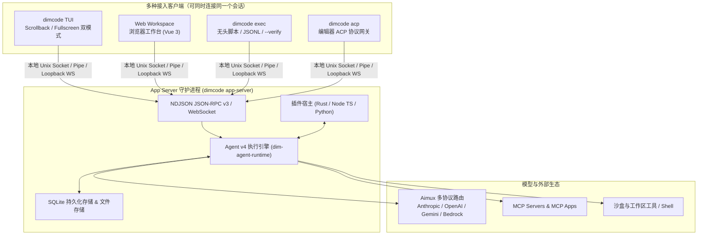

# 第 1 章：项目全景与核心设计哲学

> **本章目标**：在写第一行代码或敲第一条命令之前，先建立对 Dim（`dimcode`）的全局心智模型——它解决什么问题、凭什么与众不同，以及贯穿全项目的几条核心公理。

---

## 1.1 Dim 是什么？

如果你用过市面上的命令行 AI 编程工具（如 Claude Code、Codex CLI、OpenCode 等），你大概对它们的形态很熟悉：在终端里输入一句话，大模型流式输出回复、调用读写文件和终端工具，最后给你一个结果。

**Dim（对外发行命令行名为 `dimcode` / `dim`，Rust alpha 版亦称 `dima`）** 不只是一个命令行聊天套壳，它是一个**本地优先（Local-First）、守护进程化（Daemonized）、高度可插拔的 AI Agent 运行时与多端工作台**。

在 Dim 的设计里，**“终端界面”和“AI 执行引擎”是彻底分离的**：



这意味着：
1. 你在终端里开了一个长任务，用 `/web` 打开浏览器工作台，两处看到的**是同一个正在运行的 Session**，状态实时同步。
2. 你用 `/tui` 在“原生终端滚动历史（Scrollback）”和“全屏交互界面（Fullscreen）”之间一键切换，**Agent 正在跑的任务完全不会中断**。
3. 哪怕终端不小心关了、甚至守护进程重启了，只要从 SQLite 恢复会话，所有插件和能力都能从**时间线（Timeline）**上精确重建出断线前的状态，绝不重复执行已经产生副作用的命令。

---

## 1.2 为什么 Dim 选择这样的架构？

早期的 Agent 工具通常把“消息列表数组 + while 循环调模型 + 硬编码的 if/else 钩子”揉在一起。当功能增加到十几种（记忆压缩、权限审批、子智能体、定时任务、目标追踪、工作流、第三方插件）时，代码就会迅速退化为**“大泥球”**：
- 两个功能互相修改 `messages[]` 数组，谁先谁后说不清；
- 任务中途取消或进程崩溃，状态残缺，恢复时要么丢数据，要么把刚才跑过的 Shell 命令又跑一遍；
- 想加一个插件，得在主循环里到处塞回调函数。

Dim 的底层重构（文档中常称为 **Agent v4**）正是为了根治这些问题，它建立在**三块基石**之上：

### 基石一：Timeline（时间总线）是唯一事实源
把 Agent 的整个运行过程看作**一本只增不减的账本（Append-Only Event Log）**。
用户的输入、模型的思考、文本流、工具调用、审批请求、审批结果、分支创建、压缩摘要……全部都是账本上的一条条**事件（`AgentEvent`）**，由 Timeline 统一赋予单调递增的整数**序列号（`sequence`）**。
- **没有“隐藏状态”**：任何功能模块（不管是上下文组装、权限检查还是 UI 渲染）都不能私自维护一份与 Timeline 脱节的内存真相；内存状态只是 Timeline 的**折叠投影（Fold / Projection）**。
- **可审计、可回溯**：运行 `dimcode export <session-id>` 就能把整条时间线（包括每次真正发给模型的请求）原封不动导出来复盘。

### 基石二：Dispatcher（串行分发器）与“重建 + 实时”模型
如果说 Timeline 是数据库，那么 **Dispatcher** 就是总线上的交通警察。
- 所有提交到 Timeline 的事件，都严格按照 `sequence` 顺序**串行、非递归地**分发给订阅者（在 Dim 中称为 **Capability**）。
- 当插件热重载或会话从磁盘恢复时，Dim 使用极其优雅的 **`consume` 协议**：先挂起实时推送 → 从 Timeline 查询并折叠历史事件到某个截止序号 `cutoff` → 立即无缝放行所有 `> cutoff` 的新事件。
- **核心铁律**：重放历史事件时**只恢复内存状态，绝不重放副作用**（不会再发一遍网络请求或删一遍文件）。

### 基石三：`rutis` 单树装配与跨语言对等插件
Dim 没有自己发明一套简陋的插件接口，而是使用 [**rutis**](https://github.com/yangjuncode/dim) 作为微内核装配引擎，把整套系统组织成一棵四级作用域树：

```text
Process（整个守护进程，管配置、存储、会话列表、插件宿主）
 └── Agent（一个智能体定义）
      └── Session（一次对话工作空间，管工具集、Prompt、授权边界、多分支）
           └── Branch（一条执行线，管 Timeline、Dispatcher、AgentLoop、上下文窗口）
```

无论是 **Rust 原生核心能力**、**TypeScript/Node.js 插件**，还是 **Python 插件**，都站在**同一套契约（Service Catalog & Timeline）**之上。只要声明你属于哪个作用域（Process / Session / Branch）、注入什么服务、消费什么事件，就可以无缝接入。

---

## 1.3 Dim 的六大核心特色

在后续章节中我们会逐一拆解它们，这里先给你一张“亮点清单”：

1. **真·多分支时间线（Timeline Branches）≠ Subagent ≠ Fork**
   Dim 严格区分了三种“分叉协作”场景：
   - **Branch（分支）**：同一个 Agent 共享同一个工作空间和工具，从主线某个点分出一根子线去做调研或试错，主线和分支可异步收发消息，结果干净不污染主线上下文。
   - **Collaboration（协作子智能体）**：拉起另一个完全独立的 Session（可以用不同的模型、不同的系统提示词、不同的工具权限），像派驻一名独立同事一样交付任务。
   - **Fork（会话分叉）**：从某个历史消息把整个对话克隆成一条独立的新 Session，互不干扰地走另一条路线。

2. **Goal & Pursuit（目标自治与独立评审模式）**
   开启 `/goal` 后，Agent 不再只是“回答完一轮就停”，而是会持续推进直到目标完成或明确受阻；更特别的是 **Pursuit 模式**——可以自动拉起一条独立只读评审分支作为“考官（Judge）”，审查主分支的工作是否真的达标。

3. **双模式终端 TUI + 现代终端协议深度集成**
   - **Scrollback 模式**：完美融入系统终端自己的滚屏历史、原生复制选中，流式输出直接沉淀到终端缓冲区；
   - **Fullscreen 模式**：类 IDE 的富交互界面、可折叠工具卡片、面板弹窗、鼠标拖拽滚动条。
   - 两者通过 `/tui` **随时无损热切换**。同时还支持终端标签页状态徽标（OSC 7501）、终端原生进度条（OSC 9;4）、以及 SSH 下通过 OSC 5522 直接粘贴本地剪贴板图片！

4. **多协议统一路由（Aimux）与多模态原生管线**
   通过 `aimux` 系列 crate，Dim 原生打通 **Anthropic Messages、OpenAI Chat Completions、OpenAI Responses、Gemini GenerateContent、AWS Bedrock** 等多种 API 协议，同时内置独立的 **Modality 多模态体系**（生图、修图、增强、语音、视频、3D、本地 OCR）。

5. **极客级扩展生态：TS / Python / Rust / 纯前端 UI / CodeMode / EventHub / MCP**
   - 用几行 TypeScript 或 Python 就能写工具、Hook、Workflow 或监听事件流；
   - 用纯 HTML/CSS/JS 无需打包工具就能给 Web 端加一个 ShadowDOM 侧边栏面板；
   - **CodeMode** 允许模型在内置 `rquickjs` JS 引擎中一次写脚本编排多个工具调用，减少无效往返；
   - **EventHub** 让外部事件源可以声明主题并向订阅的会话主动投递事件。

6. **单一可执行文件，多种身份切换**
   编译或安装后通常只有一个 `dimcode` 二进制文件，它既可以是你的终端客户端，也可以作为 `dimcode app-server` 守护进程、或 `dimcode ocr-helper` 辅助进程，甚至支持 `dimcode acp` 作为编辑器协议网关运行。

---

## 1.4 必须掌握的核心术语表

读后面的源码和教程时，你会频繁遇到这些词，建议先混个眼熟：

| 术语 | 一句话大白话解释 | 对应架构层级 |
| --- | --- | --- |
| **App Server** | 常驻后台的本地守护进程，真正管会话、存盘、调模型、跑工具的大脑。 | 进程级 (`dim-app-server`) |
| **Session** | 一次完整的工作会话，绑定一个工作目录（`cwd`）、一套工具和配置，里面可以有主分支和多个子分支。 | 会话级 (`Session`) |
| **Branch / Line** | Session 内部的一条独立对话与执行线。每个 Session 默认有一条 `main` 主分支，还可以派生更多分支。 | 分支级 (`Branch`) |
| **Timeline** | 一条分支的“事件账本”，记录所有发生过的事实并分配从 1 开始递增的 `sequence` 序号。 | 分支核心 (`Timeline`) |
| **Dispatcher** | 把 Timeline 新提交的事件按序号排好队、一个个安全送到订阅者手里的串行派发器。 | 分支核心 (`Dispatcher`) |
| **Capability** | 任何注入了 `dispatcher` 或 `timeline` 的能力部件（比如 `AgentLoop`、`InputQueue`、`Approval` 等）。 | 架构概念 |
| **rutis** | Dim 使用的 Rust 反应式插件装配内核，负责依赖注入、生命周期管理和多语言桥接。 | 底层微内核 (`rutis 0.19.3`) |
| **Part / PartRegistry** | “一插件一行，多实例装配”机制：插件在 Process 层启动一次，向 `PartRegistry` 注册 Session/Branch 部件蓝图，每当有新 Session 或 Branch 打开时自动实例化挂载。 | 插件装配机制 |
| **Turn / Step / Request** | **Turn（回合）**：处理一次用户输入直到停下来的完整周期；**Request**：其中发给模型的一次请求；**Step**：模型输出或工具执行步骤。 | 执行循环 (`AgentLoop`) |
| **Steer vs Queue** | 任务运行中你又发了一条消息：**Queue** 是排队等这轮彻底干完再跑；**Steer** 是等当前工具跑完就立刻“插队纠偏”。 | 输入队列 (`InputQueue`) |
| **UI Leaf** | 终端 TUI 客户端在架构上的角色——它把自己作为一个 `rutis` 节点让 App Server 挂载上来，从而实现多客户端或双模式无缝切换。 | 客户端协议 (`UiHostPlugin`) |

---

## 本章小结

记住 Dim 最核心的一句话哲学：
> **“状态从时间线折叠而来，作用域按状态归属划分，能力通过事件总线解耦，多端只是同一个后台守护进程的不同视图。”**

下一章，我们立刻把它跑起来，带你完整走一遍安装、配置、双模式 TUI 与日常高频工作流！
