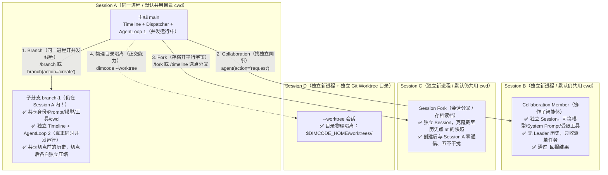

# 第 3 章：特色功能深度解析

> **本章目标**：吃透 Dim 最具辨识度的十大高阶能力——尤其是 **Branch / Collaboration / Fork / Worktree 四者边界与并发原理**、**Goal & Pursuit 自治评审模式**，以及 Workflow、Scheduler、CodeMode、EventHub、权限沙盒与多模态的运作逻辑。

---

## 3.1 杀手级特色：彻底搞懂 Branch vs Collaboration vs Fork（含目录与并发机制）

绝大多数 Agent 产品把“另起一条线干活”统统叫做“开个 Subagent”，结果经常出现工具权限混乱、上下文臃肿或文件写冲突。Dim 在架构上把这件事精准拆分成了三个独立原语（设计文档见 [`timeline-branches.md`](../docs/zh/design/timeline-branches.md)），再配合一个正交的 **Worktree 隔离机制**。

在看图之前，先直接回答最容易混淆的两个核心问题：

> [!IMPORTANT]
> **问题 1：它们是工作在同一个目录，还是各自在独立的 Worktree 目录里？**  
> **结论：三者默认全部工作在同一个工作目录（`cwd`）里，默认都不会自动创建 Git Worktree！**
> - **Branch**：永远在**同一个 Session** 内部，共用主线的 `cwd`（源码设计明确规定“没有按线隔离的工作区”）。
> - **Collaboration（Subagent）**：虽然新建了独立 Session，但看源码 [`crates/dim-app-server/src/collaboration.rs`](../crates/dim-app-server/src/collaboration.rs#L326)（`config.cwd = leader.config().cwd.clone()`），拉起 Member 时直接复用 Leader 的 `cwd`，传给 `create_session` 的 `worktree` 为 `None`。
> - **Fork**：同样继承原 Session 的 `cwd`（[`crates/dim-app-server/src/agents.rs`](../crates/dim-app-server/src/agents.rs#L1878)），只复制历史快照，不新建工作树。
> - **谁才有独立目录？** 只有显式使用 **Managed Worktree**（CLI 加 `--worktree` 启动新会话，或插件调用 `sessions.launch({ worktree: ... })`），Dim 才会在 `$DIMCODE_HOME/worktrees/<task-id>/<repo-name>` 创建独立 `git worktree` 并把新 Session 的 `cwd` 指向那里。

> [!IMPORTANT]
> **问题 2：Branch（分支）到底是怎么运行的？是两个在同时跑吗？相当于开了两个会话吗？**  
> **结论：不是开了两个 Session！它仍在「同一个 Session」内部，但底层确实是两个真正「同时并发运行」的异步执行线！**
> - 用操作系统做最直白的类比：**Session 就像一个「进程」**（拥有唯一的身份、工作目录 `cwd`、模型、系统提示词、工具集和权限策略）；**Branch 就像同一个进程里的「多个并发线程」**。
> - 当你在 `main` 分支上通过 `branch(action: "create")` 或 `/branch <提示词>` 切出一根子分支 `branch-1` 时，系统**没有创建新 Session**，而是在**同一个 Session 的 `TimelineTree`** 里新建了一条时间线，并**独立启动了一套 Branch 级的 `Dispatcher` + `AgentLoop` 异步任务**。
> - 因此：`main` 和 `branch-1` **真的在后台同时并发跑**（各自向大模型发请求、各自调工具、各自维护独立上下文窗口和独立压缩），你可以用 `/lines` 在同一会话里切来切去查看和插话；但因为它们共用同一个 `cwd`，如果同时改同一个文件会互相覆盖，所以适合**只读调研、改不同文件、或先做非破坏性验证**。

---

### 1. 用一张架构图建立心智模型

---

### 2. 四维全景对比表（源码级精确对照）

| 对比维度 | **Branch（时间线分支）** | **Collaboration（协作子智能体）** | **Fork（会话分叉）** | **Worktree（`--worktree`）** |
| :--- | :--- | :--- | :--- | :--- |
| **是不是新 Session？** | **否**（仍在原 Session 内部） | **是**（新建带 `leader_session_id` 的 Member Session） | **是**（新建完全独立的平行 Session） | **是**（创建带关联 worktree 的新 Session） |
| **是不是同时并发运行？** | **是**！`main` 与各子分支各自跑独立的 `AgentLoop` 并发执行 | **是**！Leader 与多个 Member Session 在后台各自并发执行 | **是**！分叉后两条 Session 完全独立，互不阻塞 | **是**！本质上是一个独立目录的新 Session |
| **工作目录（`cwd`）在哪？** | **同一个 `cwd`**（绝无独立目录） | **默认同一个 `cwd`**（[`collaboration.rs:326`](../crates/dim-app-server/src/collaboration.rs#L326)） | **默认同一个 `cwd`**（[`agents.rs:1878`](../crates/dim-app-server/src/agents.rs#L1878)） | **独立 Worktree 目录**（`$DIMCODE_HOME/worktrees/<task-id>/...`） |
| **模型 / 提示词 / 工具权限** | 与主线 **100% 相同**（共用 Session 配置） | **可完全不同**（可临时传 `profile` 指定小模型、只读工具白名单、专属提示词） | **继承分叉那一刻的配置副本**，之后可各自切换模型 | 独立配置（常配合 `full-access` 放手重构） |
| **历史上下文继承** | **共享切点 `at` 之前的历史**；切点之后各自独立增长、各自触发 Compaction | **零历史继承**（从空开始，只收到 Leader 下发的任务 brief） | **克隆截至静止点 `at` 的历史快照**，之后各自独立演进 | 从零开始（若仅用 `dimcode --worktree`）或由插件 `sessions.launch({ worktree })` 启动 |
| **相互通信与结果回收** | 仅 `main` ↔ 子分支双向发 `append` / `steer` 消息，并可用 `branch(action="read")` 互读日志；子分支空闲会自动通知 `main` | 仅 Leader ↔ Member 通信，Member 完成产生 `<dim-agent-report>`；**禁止 Member 再调 `request` 套娃** | **零通信**，两条平行宇宙彻底无关 | 若是独立会话则零通信；若由编排插件启动则按插件协议通信 |
| **谁不能套娃/分叉？** | 子分支**不能再开孙分支**（`branch` 工具只允许 `main` 建线） | Member **不能再招 Member**（只有一层星型团队） | **禁止对 Member Session 调用 Fork** | — |
| **TUI 操作入口** | `/branch <prompt>` 建线；`/lines` 查看、切线插话或结束 | 模型自动调 `agent` 工具；人在 `/tasks` 面板查看或中断 Member | `/fork`（在最近完成回合分叉）或 `/timeline`（选历史点分叉） | CLI 启动加 `dimcode --worktree`；`dimcode worktree list/remove/prune` 管理 |

---

### 3. 逐个深入：真实运行时到底发生了什么？

#### ① Branch（时间线分支）：同进程多线程，共享前史 + 并发探索

很多同学一开始觉得 Branch 抽象，是因为传统聊天窗口只有“一问一答一根线”。你可以把 Dim 的一个 Session 想象成 **Git 仓库里的多个分支 + 多个同时敲键盘的自己**：
- **切点之前完全共享**：假设你在 `main` 已经和模型聊了 20 轮、读完了架构文档。这时你（或模型自己调 `branch(action: "create", prompt: "...")`）在序号 `at = 42` 处切出一根 `branch-1`。`branch-1` **不需要重新读一遍这 20 轮文件**，它天然站在 `at = 42` 的全部认知基础上起跑。
- **切点之后真正并发、上下文不互相污染**：`main` 继续往下走，`branch-1` 在后台同时跑自己的 `AgentLoop`。`branch-1` 哪怕跑了 30 次 `grep`、读了 10 个大文件把自己的上下文塞满并触发了压缩（Compaction），**`main` 的上下文窗口依然干干净净**！
- **轻量通信与“相互读卷子”**：`main` 和 `branch-1` 之间不用写正式汇报文档，而是通过 `branch(action: "message", mode: "append" | "steer")` 互发简讯，或者用 `branch(action: "read")` 直接翻看对方的时间线记录；当 `branch-1` 跑完一轮进入空闲（默认 `idleNotice: "steer"`）或主动调用 `branch(action: "end", content: "...")` 时，会把精炼结论送回 `main`。
- **关键注意事项（踩坑避雷）**：**因为共享 `cwd`，不要让 `main` 和 `branch-1` 同时去改同一批文件！** 正确用法是：
  - `main` 在写方案，让 `branch-1` 去只读调研某个依赖库 / 跑测试排查报错假设；
  - 或者分工改**完全不重叠的两组文件**。

#### ② Collaboration（协作子智能体）：独立 Session 同事，换脑子、限权限、防撑爆

如果任务需要**换一个角色、换一个便宜/专用模型、或者把工具权限锁死（比如只许读不许写）**，这就绝对不能用 Branch，而要用 **Collaboration**（`agent` 工具，详见第 14 章）：
- 它会真正在 App Server 里**新建一个独立的 Member Session**（数据库记录 `leader_session_id` 与可选临时 Agent 的 `owner_session_id`）。
- **与 Branch 最大的区别**：
  1. Member **看不到 Leader 之前的 20 轮聊天记录**，它像一个刚被叫进会议室的新同事，只看你递给它的任务说明书（`prompt`）；
  2. Leader 可以现场传 `profile`，给它换用更便宜快速的模型（如只读审计员只给 `["read", "grep", "glob"]` 工具）；
  3. 即使 Member 在后台产出 50 KB 调试日志，Coordinator 也只把**带预览和 `resultId` 的 `<dim-agent-report>`** 喂给 Leader，按需调 `agent(action: "result")` 再取全文；
  4. 如果 Member 触发需要人工审批的危险操作，审批弹窗会通过 `<dim-agent-approval>` 桥接回到 Leader 这边，由你统一拍板。
- **再次提醒目录真相**：虽然 Member 是独立 Session，但源码里它**默认继承 Leader 的 `cwd`**，同样不是自动新建 Git Worktree；如果多个 Member 要同时大改同一批代码文件，需要你在外部用 `--worktree` 或由插件调用 `sessions.launch({ worktree })` 为它们分配各自的工作树。

#### ③ Fork（会话分叉）：真正的“存档读档”

你在游戏里打 Boss 前先存了个档（Save），打到一半发现选错了加点路线，于是读档重开一个新存档槽位，旧存档依然留在那儿——**这就是 Fork**。
- 当你在 TUI 输入 `/fork`（或在 `/timeline` 选定历史上的某一轮静止点 `at` 执行分叉），App Server 调用 `session.fork`：
  1. 校验 `at` 是一个安全的上下文静止边界；
  2. **新建一个全新的独立 Session**，把截至 `at` 的配置与事件全部克隆过去（关联的文件引用 `session_files` 也在 SQLite 事务内共享，不会重复拷贝磁盘文件）；
  3. 从这一刻起，**原 Session 和新 Fork 出来的 Session 彻底分道扬镳**，既不会互相发消息，也不会互相等待汇报，各自在 `/resume` 列表里作为两条独立的会话存在。
- **典型场景**：你在某条路线聊了 20 轮、背景已经铺垫完备，现在想“保留这条线继续改 A 方案，同时另外单独开一局试 B 方案”——这时候用 `/fork` 比从头开 `/new` 省掉全部前期铺垫！

---

### 4. 一句话选型口诀（实战决策树）

遇到“我想分头做点事”时，按这 4 步直接拍板：

1. **需要物理隔离代码目录、互不踩 Git 工作区？** → 启动独立 **`--worktree`** 会话（或让自动化插件通过 `sessions.launch({ worktree })` 拉起）。
2. **需要保留当前 20 轮铺垫，另开一局彻底互不干扰的新对话？** → 用 **Fork**（`/fork` 或 `/timeline` 选点分叉）。
3. **需要换角色 / 换模型 / 限制工具权限（如只读审计员、轻量执行器），做成“我派单、它交卷”？** → 用 **Collaboration**（`agent` 工具，在 `/tasks` 查看成员）。
4. **还是同一个“我”、同一个工作区和工具，只是想趁着主线思考/聊天时，顺手并发去查一段代码、验证第二个假设，且不把中间日志塞进主线上下文？** → 用 **Branch**（`/branch <prompt>` 或 `branch` 工具，在 `/lines` 切换观看）。

---

## 3.2 Goal & Pursuit 模式：从“一问一答”到“自我督战”

普通问答模式下，模型往往说一句“我建议你接下来运行一下测试”就结束了回合（`EndTurn`），把接力棒扔回给用户。

**Goal 模式（[`crates/dim-goal`](../crates/dim-goal/src/lib.rs)）** 改变了这一工作方式：
1. 在 TUI 输入 **`/goal`**，为当前分支设定一个明确的目标（Objective），例如：*“把 `dim-cli` 下的所有 clippy 警告清零，并确保 `cargo test -p dim-cli` 全部通过”*。
2. 每次 `AgentLoop` 结束一轮（`turn/end`）时，Goal 的分支状态机（`GoalBranch`）会检查目标是否已被确认完成或暂停：
   - 如果还没完，它会自动向输入队列写入一条推进提示，**自动拉起下一轮执行**，直到任务真正闭环；
   - 它同时向模型暴露 `goal_update` 工具，让模型在自认完工（`completed`）或卡住需要人工介入（`blocked`）时主动汇报。

### Pursuit（独立考官评审）模式
如果你怕模型“自欺欺人”（明明测试没跑过却自己宣布完成），Goal 提供了更强的 **Pursuit 模式**：
- 当主分支声明任务完成时，系统会**自动创建一条独立的评估分支（Evaluator Branch）**；
- 考官分支以**只读视角**接手审查，独立运行检查或阅读代码，验证主分支到底有没有真正满足 Goal 目标；
- 只有考官通过了，Goal 才算真正完成；如果不通过，考官的驳回意见会反馈回主分支继续修复！

---

## 3.3 Workflow（工作流）与 Scheduled Tasks（定时任务）

### Workflow（结构化多阶段工作流）
位于 [`runtime/plugins/workflow`](../runtime/plugins/workflow/index.ts)，是 Dim 内置的 TypeScript 官方插件示范：
- 你可以把一组固定的高频工程流程（如“代码变更审查 → 补充单测 → 生成变更日志”）定义成带参数（Schema）的 Workflow 文件（保存在用户目录或项目 `.dimcode/workflows/`）。
- 通过 **`/workflow`** 选择工作流、填入参数并启动，或用 **`/workflow:save`** 把一次成功探索直接固化成工作流模板；支持查看各阶段（Stages）日志、状态及随时中止。

### Scheduled Tasks（定时巡检与周期任务）
由原生 Rust crate [`dim-agent-scheduler`](../crates/dim-agent-scheduler/src/lib.rs) 提供：
- 支持在 TUI 中通过 **`/scheduled`**（别名 `/schedule`）面板、CLI `dimcode scheduled ...`，甚至**让模型自己调用 `schedule` 工具**来创建、编辑、暂停、立即触发定时任务。
- 每个任务可配置：执行周期、Prompt 指令、工作目录、指定模型，以及**“每次新建 Session”还是“复用同一个 Session 持续累积上下文”**。
- **重要边界**：定时任务由运行中的守护进程/活跃客户端驱动触发；如果机器关机或进程休眠错过了某个时间窗，恢复后**不会积压补跑（Skip missed windows）**，避免醒来瞬间连发十几次 API 请求。

---

## 3.4 Skills、Hooks 与按需信任边界

### Skills（可按需加载的专业技能包）
Skill 本质上是一个包含 `SKILL.md`（外加可选脚本、参考文档、示例）的目录，支持四个来源：用户目录、项目目录、插件自带以及自定义配置目录。
- 为什么 Skill 比全塞进 System Prompt 更好？因为系统启动时只把**极简的技能名称和一行描述**告诉模型；只有当任务相关、或你在输入框显式键入 **`/skill:<name>`** 时，完整技能指南才按需注入上下文，极大节省 Token 与注意力。
- 常用命令：`/skills`、`/reload-skills`、`dimcode skills list/enable/disable`。

### Hooks（命令级生命周期钩子）
在关键节点（例如用户输入提交前 `UserPromptSubmit`、工具执行前后、回合结束 `Stop` 等）挂载外部脚本或命令：
- 例如提交检查钩子可以拦截不合规的输入（返回 `input_blocked` 阻止提交），或在失败且设置 `onFailure: continue` 时在 UI 边上给出黄色警告条（`warnings`），而不会污染模型上下文。
- 常用命令：`/hooks`、`dimcode hooks list/enable/disable/edit`。

### 安全铁律：为什么项目自带扩展默认“关闭”？
根据 [**ADR 003**](../docs/adr/)，任何来自**未知项目仓库内部**的插件、Hooks、项目级 MCP Server、甚至高危能力，**默认都是关闭（Disabled）状态**！只有用户自己在本地配置或通过交互命令显式 `enable` 之后才会生效。这从源头上杜绝了 `git clone` 一个恶意仓库并打开 `dimcode` 就立刻触发任意代码执行的供应链风险。

---

## 3.5 效率引擎：CodeMode 与 EventHub

### CodeMode（`crates/dim-codemode`）
当模型需要做“批量读 15 个文件并统计某个模式、过滤出符合条件的结果再调用另一个工具”这种机械性编排时，传统做法要跟大模型来回交互 15 轮，既慢又烧钱。
- Dim 内置了基于 **`rquickjs`** 的轻量嵌入式 JS 沙盒 **`codemode`** 工具；
- 模型可以直接写一小段 JavaScript 脚本，在沙盒内并发/循环调用宿主暴露出的受控嵌套工具（`NestedToolHost`），计算汇总后只把最终精炼结果返回给模型——**把 N 轮模型往返压缩成 1 轮**。

### EventHub（`crates/dim-event-hub`）
Agent 不应该永远被动等人类敲回车。EventHub 在 Process 级提供了一个**发布-订阅事件总线**：
- 任何插件或外部桥接服务都可以向 `eventHub` **声明（`declare`）**一种事件源与事件类型；
- 会话分支可以通过 `events` 工具或 API **订阅（`subscribe`）**特定事件源；
- 当事件发生并 `publish` 时，EventHub 自动把事件投递到目标分支的输入队列中唤醒 Agent 处理。

---

## 3.6 权限预设、审批流与操作系统沙盒

Dim 对"谁来控制模型的手脚"划分得极其清晰：

1. **三大权限预设（`/permissions` 或 `--permission`）**：
   - `read-only`：只读探查模式，写文件、执行危险命令均受限或需审批；
   - `workspace-write`：允许在当前工作区及授权目录读写，越界或敏感命令需确认；
   - `full-access`：完全放行（通常配合 `--worktree` 或容器使用）。
2. **命令行细粒度规则（Command Rules）**：支持按命名前缀或匹配规则设置 `Allow` / `Ask` / `Deny`（持久化在 `settings` 中），并在审批弹窗时支持“本次允许”或“记住规则”。
3. **Host 级 Sandbox**：在支持平台（macOS / Linux）上限制 Shell 子进程的文件系统写范围与网络访问，作为最后一道物理防线。
4. **重要边界**：Approval/Permission 管辖的是**大模型自主发起的工具调用**；用户自己显式开启的本地 Hooks、配置好的 MCP 服务和定时任务属于宿主显式配置，不经工具审批弹窗拦截。

---

## 3.7 多模态管线（Image / Modality / OCR）与 Worktree

- **通用多模态引擎（`dim-modality` + `dim-modality-aimux`）**：支持文生图（`image generate`）、图生图/遮罩编辑（`image edit`）、超分/去背景/修复（`image enhance`）、图像理解（`image read`），以及面对特定宿主扩展的视频、语音合成/转写、音乐、音效、3D 资产、动作生成与实时会话接口。支持 `dimcode modality` 查看各能力与默认模型路由，`dimcode modality task` 追踪异步长任务。
- **本地 OCR（`dim-ocr` + `light-ocr`）**：通过 `dimcode ocr <图片或PDF>` 或内部 `ocr-helper` 子进程识别复杂文档与 PDF 中的文字与排版。
- **Git Worktree 隔离任务（`--worktree`）**：当你希望 Agent 放手大干一场重构，又不想弄乱自己当前正在改的分支时，加上 `--worktree` 启动会话。App Server 会自动在 `$DIMCODE_HOME/worktrees/<task-id>/<repo-name>` 中创建一个由 Dim 管理的独立 Git Worktree，用完后可通过 `dimcode worktree list/remove/prune` 优雅清理。

---

## 本章小结

这一章我们纵览了 Dim 真正拉开差距的核心特色：**用 Branch/Collaboration/Fork/Worktree 精准分离并发、角色与目录隔离边界，用 Goal/Pursuit 实现自我驱动与评审，用 CodeMode 提速工具编排，用 EventHub 接入异步事件，用默认关闭+沙盒守住安全底线。**

下一章，我们将视角放大到进程外：看看 **Web 工作区、无头 CI 自动化、ACP 编辑器网关和 MCP 生态** 是如何共用同一个 App Server 大脑的。
