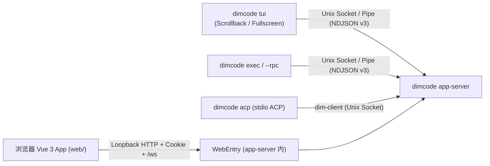

# 第 4 章：客户端生态、Web 工作区与外部协议

> **本章目标**：理解 Dim 的“守护进程 + 多端接入”架构——看看本地 TUI、Web 工作区、无头 CI、ACP 编辑器网关和 MCP 是如何通过同一套 App Server 协议协同工作的。

---

## 4.1 为什么所有终端最终都连向 App Server？

在许多早期命令行 Agent 工具中，CLI 进程就是全部：你开两个终端，它们各自读写同一份文件、各自跑状态，甚至关闭终端进程任务就当场死亡。

Dim 采用的是 **C/S（本地客户端 + 守护进程）架构**：
- **App Server（[`crates/dim-app-server`](../crates/dim-app-server/README.md)）** 是唯一掌握“真相”的守护进程：它持有 `SQLite` 数据库（`<home>/rust/dimcode.sqlite`）、配置、Provider 凭据、MCP 连接、Plugin 宿主机以及 `Agent v4` 的全部 Session/Branch 内存与执行生命周期。
- **所有客户端**（TUI、Line Client、`exec`、Web 浏览器、ACP 网关）都只负责**展示与输入**，通过 **受保护的本地传输通道**（Unix Domain Socket / Windows Named Pipe 上的 **NDJSON JSON-RPC v3**，或受鉴权的本地环回 WebSocket）与 App Server 对话。



### 安全传输红线
正因为 App Server 能读写代码、执行本地 Shell、读取凭证，它对传输层做了严格隔离：
- 默认的保护性 Profile（Product / Configured）要求**管理面与执行面 RPC 必须走受本地文件系统权限保护的 Unix Socket / Pipe**；
- 裸露在外的未鉴权 `/ws` 端口默认被禁用（`--no-ws`），即便开启也只响应 `hello` 和 `ping`（仅测试用的 `mock` profile 例外）。

---

## 4.2 奇思妙想：UI Leaf（UI 叶子节点）机制

你可能会好奇：既然 TUI 是独立进程，App Server 怎么知道哪些 Session 上挂着哪个终端？如果我在终端里开着一个 Session，还能再开一个或者切换 Scrollback / Fullscreen 吗？

这里有一个非常精妙的设计叫 **UI Leaf**（见 [`crates/dim-app-server/README.md`](../crates/dim-app-server/README.md)）：
1. App Server 内部有一个进程级 Capability 叫 **`UiHostPlugin`（提供 `UiHost`）**，充当“UI 注册表”。
2. 交互式的 `dimcode` 客户端自己也启动了一个轻量 `rutis` 内核并监听一个私有本地地址。
3. 当界面挂接会话时，App Server 可以通过 `ui.open` 作为**叶子连接（`UiLeaf`）**反向拨号到该客户端的本地地址进行握手确认，同时客户端的业务界面通过普通协议 v3 的 `ui.attach` 绑定到具体 Session。
4. 于是，**同一个 Session 可以同时拥有任意多个 UI 观察者**（例如一个 Fullscreen TUI + 一个 Web 工作区 + 一个手机端），各自通过同一条事件流刷新画面；当你执行 `/tui` 切换模式时，甚至可以做到新界面上线（`ui.open { replace }`）成功后再无缝替换旧界面，Session 本身纹丝不动！

---

## 4.3 Web Workspace：浏览器里的 Dim 工作台

如果你更习惯在大屏浏览器里并排看长篇代码 Diff、管理分支树、或者浏览扩展面板，Dim 内置了一套完整的 **Vue 3 + Vite Web 前端**（位于仓库 [`web/`](../web) 目录）。

### 两种打开方式
1. **命令行独立持有者模式**：
   ```bash
   dimcode web            # 打开本地环回端口（默认从 43201 起找空闲端口），打印带一次性引导口令的 URL
   dimcode web --port 45000
   dimcode web --off      # 关闭守护进程上的开关（不影响前台仍在运行的前台 holder）
   ```
   前台运行 `dimcode web` 时，该连接作为 `holder` 一直保持监听；按 `Ctrl+C` 退出后，如果没有开启 TUI 开关，Web 入口自动关闭并吊销所有 Token。
2. **TUI 内一键开关**：
   在终端对话中直接输入 **`/web`**，调用 `web.toggle` 由守护进程自己持有开关，终端可以继续干别的事。

### WebEntry 的安全鉴权链路（非常值得学习）
Web 端虽然只监听 `127.0.0.1`（Loopback），但依然面临 **DNS Rebinding** 与本地恶意网页窃取接口的风险。[`crates/dim-app-server/src/web_entry.rs`](../crates/dim-app-server/src/web_entry.rs) 做了教科书级的防御：
1. **URL Fragment 传口令**：生成的链接形如 `http://127.0.0.1:43201/#bootstrap=<32字节随机base64url>`。`#` 后的片段**永远不会随 HTTP 请求发到服务端日志或 `Referer` 头**。
2. **一次性交换 HttpOnly Cookie**：前端 JS 取出 `#bootstrap` 调 `POST /api/auth/exchange` 换取 `Set-Cookie: dim_web=<access>; HttpOnly; SameSite=Strict; Path=/`（服务端内存只存 SHA-256 哈希）。失败 5 次后触发指数退避限流（最高 60 秒 429）。
3. **严格 `Origin` 与 `Host` 校验**：所有 `POST` 和 `/ws` 升级请求，必须满足 `Host` 为绑定的环回地址，且 `Origin == http://<Host>`。
4. **安全响应头**：全站响应自带严格 CSP（`default-src 'self'; frame-ancestors 'none'`）和 `Referrer-Policy: no-referrer`。
5. **最小权限暴露**：Web 连接进入 App Server 后标记为 `entry: Web`，**只允许调用 Session 执行方法、只读模型发现与 UI 扩展列表**，绝不允许直接调用 `daemon.shutdown` 或全局危险管理方法。

> **源码编译提醒**：正式发行的 `dimcode-web` 资源是独立产物（或由 `dimcode web install` 下载）。在源码开发环境下，你可以把前端编译目录通过环境变量 `DIMCODE_WEB_ASSETS` 传入 `./dev`，或者编译时启用 Cargo feature `embedded-web` 将 `web/` 构建产物直接 gzip 内嵌进二进制文件中！

---

## 4.4 无头自动化神器：`dimcode exec`

想把 Dim 接进 GitHub Actions、本地 Git Hook、或者自定义自动化脚本？`dimcode exec` 专为无人值守场景打造：

### 1. 文本 + 管道 + 图片单次运行
```bash
# 直接执行一段指令
dimcode exec -p "总结最近 5 个 commit 的改动风险"

# 从 stdin 读入（例如日志分析），并附带截图
cat build_error.log | dimcode exec --image ui_bug.png
```

### 2. `--json` 流式事件输出（可机读 JSONL）
```bash
dimcode exec -p "检查并发竞争条件" --json > events.jsonl
```
- `stdout` **绝对纯净**：每行一个标准 JSON-RPC 通知，方便 `jq` 或脚本解析。
- 诊断信息、Session ID 句柄、缩放图片提示、Hook 警告全部走 `stderr`。
- **退出码契约**：如果在无人值守下模型触及需要人类审批（Approval）或提问（Question）的操作，会自动拒绝/中止该分支并**返回退出码 `3`**（`Ctrl+C` 等待干净结算后返回 `130`）。

### 3. `--verify` 自动验证与自愈修复闭环
这是非常实用的工程特性：
```bash
dimcode exec \
  -p "把用户模块的日期解析重构为 chrono" \
  --permission workspace-write \
  --verify "cargo test -p user-module" \
  --repair-attempts 3
```
Agent 改完代码后，`exec` 会自动跑你指定的 `--verify` 命令；一旦失败，自动把失败输出反馈给模型让它继续修，最多循环 `--repair-attempts` 轮，直到测试全绿！

### 4. `--rpc` 常驻 JSON-RPC 服务
通过 `dimcode exec --rpc` 启动一个基于标准输入输出的常驻多会话 JSON-RPC 引擎，适合上层编排系统直接把 Dim 作为子进程内核驱动。

---

## 4.5 编辑器联动（ACP 网关）与 MCP / MCP Apps

### ACP Gateway（[`crates/dim-acp`](../crates/dim-acp/src/lib.rs)）
**ACP（Agent Client Protocol）** 是连接现代代码编辑器（如 Zed 等支持 ACP 的客户端）与外部 AI Agent 的标准协议。
- 运行 `dimcode acp [--agent ID]` 后，它会挂载 [`AcpGateway`](../crates/dim-acp/src/lib.rs) 插件，在 `stdin/stdout` 上接收编辑器发来的 ACP 帧（16 MiB 帧上限），内部通过 [`dim-client`](../crates/dim-client/) 透明桥接到本机的 App Server 执行。
- 它本质上只是 App Server 的**又一个协议投影端**，因此你在编辑器里用 ACP 跑的会话，同样可以在 `dimcode` 里用 `/resume` 接着聊或用 `dimcode export` 导出！

### MCP 与 MCP Apps
Dim 完整支持 **Model Context Protocol (MCP)**，具备三种传输方式（本地 stdio 进程、HTTP、SSE）与完整 OAuth 鉴权流：
- 命令行一站式管理：`dimcode mcp list / add / test / login / enable / disable / inspect`。
- **从其他工具一键迁移**：`dimcode mcp import --discover` 可以自动探测本地已装的其它 AI 客户端配置，预览后通过 `--yes` 选定导入，省去手动抄配置之苦。
- 同样遵循安全边界：项目 `.mcp.json` 里的服务默认关闭，需显式启用。

---

## 4.6 演进中的蓝图：RemoteGateway（远程与手机配对）

在 [`docs/design/plugins/RemoteGateway.md`](../docs/design/plugins/) 与 [`docs/feature-list.md`](../docs/feature-list.md) 中，Dim 设计了面向移动端和跨设备接力的 **RemoteGateway** 架构（当前仓库处于设计规划与 Phase 1 `WebEntry` 演进阶段）：
- 目前已落地的 **Phase 1 `WebEntry`** 专注于本机环回接入与轻量 Cookie 鉴权；
- 目标设计中的 **RemoteGateway** 将进一步补齐二维码/配对码（`remote-devices.json`）、每设备独立可吊销 Token、TLS/公网中继以及手机端接管终端会话等能力，而浏览器前端代码无需重写（继续复用同一套协议 v3/v4 Session 接口）。

---

## 本章小结

这一章我们看清了 Dim 的“外部形态”：
- **核心在 App Server**：所有状态与计算集中在一处；
- **客户端即视图**：TUI（Scrollback/Fullscreen）、Web Workspace、Headless `exec`、ACP 编辑器网关共用同一个引擎；
- **边界极度克制**：本地 Socket 跑高危管理接口，Loopback Web 用 URL Fragment + HttpOnly Cookie + 严格 Origin 检查守住安全。

从下一章起，我们正式进入**第二篇：底层架构与源码剖析**，掀开引擎盖看看 `27` 个 Rust Crate 是如何各司其职、优雅协作的！
