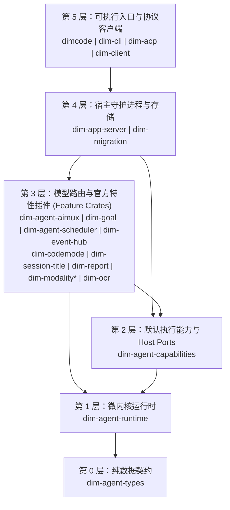

# 第 5 章：代码仓库导览与 27 个 Crate 分层架构

> **本章目标**：拿到源代码不迷路——熟悉整个仓库目录、单二进制多角色启动机制、27 个 Cargo Workspace Crate 的职责地图，以及 `xtask` 如何用自动化规则防止架构腐化。

---

## 5.1 仓库全局目录导览

打开 `/home/yj/github.com/yangjuncode/dim` 根目录，最关键的目录与文件如下：

```text
dim/
├── Cargo.toml               # 27 个 Rust workspace crate 清单与统一依赖版本
├── rust-toolchain.toml      # 锁定 Rust 1.100.0 (2024 edition)
├── dev                      # 开发者隔离启动脚本 (~/.dimcode-dev)
├── AGENTS.md                # 工程铁律、数据边界与 Agent v4 开发规范
├── crates/                  # 核心 Rust Crates（详见 5.3 节）
├── xtask/                   # 架构检查、服务目录生成、性能测量与评估工具
├── runtime/                 # 非 Rust 插件宿主与内置 TS/Python 插件、测试夹具
│   ├── plugins/             # 官方内置插件（workflow、plugin-authoring、light-ocr）
│   └── fixtures/            # TS 与 Python 跨语言契约测试夹具
├── web/                     # Web Workspace Vue 3 + Vite 前端源码
├── npm/                     # 发布的 npm 包装器与生成的 TS 类型 (plugin.d.ts / branch-services.d.ts)
├── examples/                # 二次开发示例（如 ui-extensions 纯前端扩展）
├── tests/                   # 跨 Crate 集成测试（如 extension-a / extension-b）
└── docs/                    # 详尽的架构文档、ADR 决策记录与插件契约
    ├── architecture/        # 系统架构图、rust-agent 公理与自动生成目录
    ├── adr/                 # ADR 001 ~ 006（核心架构决策）
    └── design/              # 详细的接口设计与各插件规范
```

---

## 5.2 巧妙的设计：单二进制多角色入口

很多项目会把 CLI、Daemon、Helper 拆成好几个独立可执行文件，用户安装分发时极易版本错配。Dim 在 [`crates/dimcode/src/main.rs`](../crates/dimcode/src/main.rs) 用了一个极其干练的**“单二进制多角色（Multi-Role Binary）”**模式：

```rust
// crates/dimcode/src/main.rs 核心分流逻辑（示意）
fn main() {
    let mut args = std::env::args_os().peekable();
    let _bin = args.next();
    match args.peek().and_then(|s| s.to_str()) {
        Some("ocr-helper") => dim_ocr::helper_main(...),
        Some("--migrate-prompt-references") => { /* 离线数据库迁移 */ }
        Some("app-server") => {
            // 注册所有内置原生特性插件后，启动 App Server 守护进程
            dim_app_server::cli::process_entry_with_plugins(..., install)
        }
        _ => {
            // 默认身份：作为轻量客户端运行 TUI / exec / acp / 管理子命令
            // 需要后台守护进程时，自动派生 `self_exe app-server`！
            dim_cli::run_cli()
        }
    }
}
```

看看这里发生了什么：
1. 你日常运行 `dimcode` 时，它进入 `dim_cli::run_cli()`；
2. 如果后台还没启动 App Server，客户端会自动把自己（`current_exe()`）加上参数 `app-server` 拉起作为后台守护进程；
3. 当进入 `app-server` 身份时，[`dimcode/src/main.rs`](../crates/dimcode/src/main.rs) 里的 `install()` 函数负责把所有内置原生 Rust Feature 插件装配到 `AgentBuilder` 中：
   - `dim_session_title::install`（自动会话标题）
   - `dim_agent_scheduler::install`（定时任务）
   - `dim_event_hub::install`（事件总线）
   - `dim_goal::install`（Goal / Pursuit 模式）
   - `dim_report::install`（诊断报告）
   - `dim_codemode::install`（JS 沙盒工具编排）
   - `dim_modality::install` + `dim_modality_aimux::install`（多模态管线）
   - `dim_image_understanding::install`（图像理解）
   - `dim_ocr::install`（OCR 文字识别）
   - （可选构建时 OAuth）`dim_oauth::row()`

> **二次开发启示**：如果你想把自己的 Rust Feature Crate 编译进发行版 `dimcode`，只需要在 `dimcode/Cargo.toml` 添加依赖，并在 `crates/dimcode/src/main.rs` 的 `install()` 里加上一行 `my_crate::install(builder);`！

---

## 5.3 27 个 Crate 的清晰分层地图

依据自动生成的依赖图 [`docs/architecture/rust-agent/generated/crates.mmd`](../docs/architecture/rust-agent/generated/crates.mmd)，整个 Workspace 严格分为**五层**，依赖方向只能**自上而下**，绝不允许循环或跨层污染：



下面逐层盘点每个核心 Crate 的准确职责：

### 第 0 层：纯契约层（Pure Contracts）
- **`dim-agent-types`**：**没有任何 Tokio、HTTP 或 `rutis` 依赖**！纯粹定义所有跨边界数据结构：`AgentEvent`、`EventKind`、`EventDraft`、`ModelRequest`、`ToolCall`、`ToolResult`、`UserInput`、`PermissionPreset`、`RESERVED_DOMAINS` 以及向后兼容模块 `v1`。

### 第 1 层：通用运行时内核（Kernel）
- **`dim-agent-runtime`**：提供 `AgentBuilder`、`Agent`、`Session`、`Branch` 门面，核心 **`Timeline`** 与 **`Dispatcher`**，以及 `PartRegistry`、结构化查询引擎 `TimelineQuery`、`ServiceCatalog` 和内存测试存储 `MemoryTimelineStore`、`MinimalHost`。
  - **关键边界**：它**完全不知道**什么叫 `AgentLoop`、不知道怎么调 LLM、也不知道文件工具和 SQLite！

### 第 2 层：默认能力层（Default Capabilities）
- **`dim-agent-capabilities`**：实现了组成一个标准编程智能体所需的全部默认能力（Capabilities）与**宿主端口（Host Ports）**：
  - 核心执行：`AgentLoop`、`InputQueue`、`ContextPreparation`、`ContextUsage`、`PromptRegistry`
  - 工具与权限：`ToolRegistry`、`ToolBinding`、`ToolExecutor`、`Permission`、`Approval`
  - 工作区与并发：`WorkspaceTools`（read/write/edit/glob/grep）、`ShellSession`、`BackgroundExec`、`Wait`、`TimelineTree`、`BranchLine`、`Collaboration`、`Recall`
  - 对外宿主接口（`host::*`）：`ModelHost`、`StorageHost`、`HostPlatform` 等，供上层 App Server 或自定义嵌入宿主去实现。

### 第 3 层：模型与扩展特性插件（Capabilities & Features）
- **`dim-agent-aimux`**：把 `aimux-core` / `aimux-providers` 封装成 `AimuxPlugin` 与 `ConfiguredModelPlugin`，负责模型目录、请求构建与多协议流式解析。
- **内置可插拔 Feature Crates**：
  - `dim-goal`（Goal & Pursuit 自动推进与评审）
  - `dim-agent-scheduler`（定时任务调度与运行历史）
  - `dim-event-hub`（跨会话发布-订阅事件中心）
  - `dim-codemode`（`rquickjs` JS 沙盒多工具编排）
  - `dim-session-title`（调用辅助模型自动生成会话标题）
  - `dim-report`（独立问题/错误诊断报告生成）
  - `dim-modality` / `dim-modality-aimux` / `dim-image-understanding` / `dim-ocr`（多模态与文档 OCR）
  - `dim-oauth`（构建期 OAuth 客户端配置）

### 第 4 层：App Server 宿主（Host & Persistence）
- **`dim-app-server`**：真正组装并托管运行时的守护进程：
  - 实现 `SqliteTimelineStore`、`FileStorage`、Settings（`settings_documents`）、`PluginManager`、`RuntimeManager`（拉起 Node/Python 子进程）、`McpHost`、`WebEntry`、`UiHostPlugin`；
  - 对外提供协议 v3 NDJSON RPC、管理方法和 Session 方法。
- **`dim-migration`**：负责从早期历史版本（`~/.dimcode/v2` 等）安全迁移数据到当前 Rust SQLite 存储。

### 第 5 层：客户端与网关（Clients）
- **`dim-client`**：供客户端复用的强类型 RPC 连接库。
- **`dim-cli`**：纯 Rust 终端交互界面（内置 Scrollback 渲染器与基于 Ratatui/`grok-build` 的 Fullscreen 渲染器）、剪贴板与图片缩放、所有 CLI 管理子命令。
- **`dim-acp`**：ACP（Agent Client Protocol）标准输入输出网关。
- **`dimcode`**：最终打包的唯一主二进制入口。

---

## 5.4 `xtask`：让架构契约“长出牙齿”

很多大型项目文档写得天花乱坠，三个月后代码就改得和文档完全对不上。Dim 用仓库里的 [`xtask`](../xtask/src/main.rs) 彻底解决了“文档与代码脱节”问题，直接把架构检查写进了 CI：

| 命令 | 作用 |
| --- | --- |
| `cargo run --locked -p xtask -- check` | **核心一致性门禁**：校验 Crate 依赖边界是否越线、`catalog.md` 服务目录是否最新、`npm/branch-services.d.ts` TS 类型是否同步、注释里的文档链接是否有效！ |
| `cargo run --locked -p xtask -- graph` | 从真实的 Rust `#[rutis::service]` 宏、模块注册和插件装配中，**自动生成** [`catalog.md`](../docs/architecture/rust-agent/generated/catalog.md)、[`crates.mmd`](../docs/architecture/rust-agent/generated/crates.mmd) 和 `modules.mmd`。 |
| `cargo run --locked -p xtask -- types` | 自动把 Rust 跨语言服务接口导出生成 TypeScript 声明文件 [`npm/branch-services.d.ts`](../npm/branch-services.d.ts)。 |
| `cargo run --locked -p xtask -- measure` | 对运行时的内存占用（自定义分配器追踪）、启动性能与关键路径进行量化压测。 |
| `cargo run --locked -p xtask -- context-replay / restore-replay` | 使用真实 SQLite 数据库离线重放某次会话的上下文构建或恢复过程，用于深度回归调试。 |

---

## 本章小结

记住这张分层红线：
- **`dim-agent-types` 不碰任何运行时**；
- **`dim-agent-runtime` 不碰任何大模型和工具业务**；
- **`dim-agent-capabilities` 定义业务端口而不写死持久化实现**；
- **`dim-app-server` 与各独立 Feature Crate 在顶层自由拼装**。

理清了骨骼结构，下一章我们深入 Dim 最灵魂的部件——**Timeline 时间总线与事件模型**！
