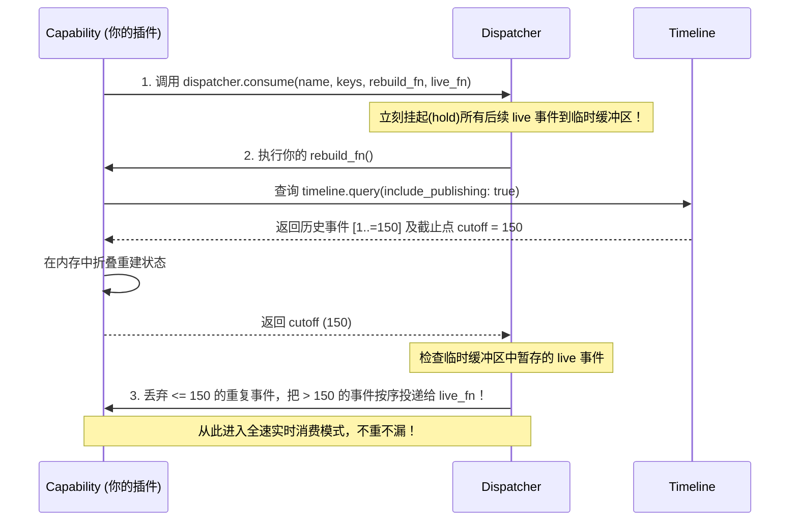

# 第 7 章：并发模型 —— Dispatcher、Capability 与状态重建

> **本章目标**：理解 Dim 最核心的并发与恢复算法——串行 `Dispatcher` 为什么能杜绝乱序竞态、`Capability` 到底是什么，以及跨语言通用的 **`dispatcher.consume` 无缝重建协议**究竟是如何做到既能热重载又不重放副作用的。

---

## 7.1 为什么 Dispatcher 必须“严格串行且禁止递归”？

当一次模型请求正在运行、后台 Shell 刚刚吐出结束信号、用户同时又按了 `Esc` 中断——这些事情在异步 Rust 里可能在同一微秒并发触发。如果谁写入 Timeline 就由谁直接异步广播给所有监听器，后果必然是：
- 监听器 A 先看到事件 11 再看到事件 10；
- 监听器 B 在处理事件 10 的回调里当场又向总线发了一个事件 11，导致嵌套锁死或状态撕裂。

[`crates/dim-agent-runtime/src/core/dispatcher.rs`](../crates/dim-agent-runtime/src/core/dispatcher.rs) 中的 **`Dispatcher`** 制定了两条铁律：
1. **严格按 `sequence` 单线串行派发**：Timeline 提交锁每放行一个事件（或一个批次），`Dispatcher` 就会按 `sequence` 从小到大，在一条专属私有总线通道（`dim/timeline/{instance}/committed`）上，逐个等待订阅者处理完事件 N，再派发事件 N+1。
2. **禁止在订阅回调中直接递归等待发新事件阻塞总线**：如果需要针对某个事件写后续事件（例如 `GoalBranch` 在收到 `turn/end` 后写入下一轮 `input`），不要在回调里死等新事件再次派发给自己，而是通过受管异步任务（`TaskTracker`）提交，或者只改变状态由外部写任务去执行！
3. **故障隔离与精准归因**：如果某个订阅者在处理事件时 `panic` 或返回错误，`Dispatcher` 内部的 `SubscriptionListener` 会捕获它，把错误精准归因到该订阅者名称（`AgentError::fault(name, ...)`），并安全地熔断这条分支的派发（发布到 `DispatchState`），防止带着残缺状态继续瞎跑。

---

## 7.2 什么是 Capability？认识 20 个内置 Capability

在 Dim 的架构术语里，**Capability** 有一个极其精确的定义（[`docs/design/plugin-contract.md`](../docs/design/plugin-contract.md)）：

> **任何注入了 `dispatcher` 或 `timeline` 的部件（Part），就是这个分支的一名 Capability。**

无论它是 Rust 写的、TypeScript 写的还是 Python 写的，只要它在 `branch` 作用域注入了 `dispatcher`/`timeline`，它就和核心引擎平起平坐地参与事件消费。

查看由 `xtask graph` 自动生成的 [`docs/architecture/rust-agent/generated/catalog.md`](../docs/architecture/rust-agent/generated/catalog.md)，当前仓库共有 **20 个内置 Capability**，它们各守一摊，互不侵入：

| 类别 | 内置 Capability 部件 |
| --- | --- |
| **回合与上下文引擎** | `AgentLoop`、`InputQueue`、`ContextPreparation`、`ContextUsage`、`Prompt` |
| **模型与恢复** | `ModelRecovery`（错误重试与接力恢复） |
| **工具、审批与权限** | `ToolExecution`、`ToolApproval`、`Permission`、`Recall` |
| **子任务与分支协作** | `BackgroundExec`、`BranchLine`、`BranchMessage`、`Collaboration`、`WaitBranch`、`WaitExec`、`WaitCollaboration` |
| **生命周期与高阶特征** | `BranchLifecycle`、`GoalBranch`、`CodeModeBranch` |

看看这种“高内聚、零耦合”的威力：比如 `ContextUsage` 只管监听 `model/usage`、`context/compaction` 和 `turn/end` 来统计最新 Token 用量；`ToolApproval` 只管监听 `approval/request`、`approval/respond`、`approval/cancelled` 来维护待审批清单。它们彼此之间**甚至不需要相互 `import`**！

---

## 7.3 灵魂算法：`dispatcher.consume`（重建与实时无缝衔接）

这是整套 Dim 运行时最值得你反复玩味的工程设计。

设想一个真实场景：
> 你的对话分支已经跑了 150 条事件（`sequence = 1..=150`）。就在第 150 条刚写完准备发第 151 条的一瞬间，你执行了 `/reload-plugins` 热重载一个插件，或者整个 App Server 刚刚从崩溃中重启恢复 Session！

如果新挂载的插件简单地写：
1. 先 `timeline.query` 查询历史事件；
2. 查完再 `dispatcher.subscribe` 订阅实时事件。

**经典竞态 Bug 马上出现**：在第 1 步查询结束、第 2 步还没订阅上的那几毫秒之间，正好有个第 151 条事件提交并派发过去了——插件永久漏掉了第 151 条！如果先订阅再查询呢？第 150 条又会被处理两遍！

Dim 的 **`dispatcher.consume`** 协议用三步彻底根治了这个分布式经典难题：

### 细节魔鬼：`include_publishing: true` 是干嘛的？
在 `Dispatcher` 把事件送进总线的那一刹那，这个事件**已经写进 `Timeline` 了**（拥有了序号，处于“正在发布中 publishing”状态），但可能正因为某个慢监听器还没走完，全局 `committed()` 游标还没推过它！
如果 `rebuild()` 查询时没加上 **`include_publishing: true`**，你拿到的历史记录就可能少于正在广播的那条事件，导致“既不在历史查询里，又因为序号关系被过滤”的缝隙。带上 `include_publishing: true`，再把查询返回的真实最大序号 `page.through` 作为 `cutoff` 交还给 `Dispatcher`，数学上就能 **100% 证明不重、不漏、严格有序**！

> **什么时候用 `listen` / `subscribe`，什么时候用 `consume`？**  
> - 如果你的插件**有自己要维护的内存状态**（哪怕只是数一条消息数了几次），请**一律使用 `dispatcher.consume`**！  
> - 只有完全无状态、只对未来新事件做反应的小部件，才适合纯 `listen` / `subscribe`。

---

## 7.4 三大行为铁律：防重放、防过时写入与可取消性

写一个合格的 Capability，必须时刻铭记 `time-bus.md` 的三条行为铁律：

### 铁律 1：重建只算内存，绝不重放副作用（No Side-Effect Replay）
在 `rebuild()` 阶段折叠第 1～150 号历史事件时：
- **允许做**：更新计数器、拼接状态机、恢复待审批表、记录上次是否已发送某通知；
- **绝对禁止做**：再次执行 Shell 命令、再次向外部 Webhook 发 HTTP 请求、再次往 Timeline 写重复事件！
只有当事件通过 `live` 回调真正到达、且结合折叠状态确认“尚未处理”时，才触发对外副作用。

### 铁律 2：写入前重检（Pre-write Recheck）
假设你在 `sequence = 100` 时决定调用 `timeline.append` 写一个“自动继续推进”的事件；等你准备提交时，用户正好按了 `Esc` 写入了 `sequence = 101 (stop/interrupt)`！
因此，任何涉及状态跃迁的写入动作，在落盘前（或通过 `before` / 原子检查）必须确认当前状态依然允许这个动作；如果中途出现了中断或状态已经改变，应安静放弃而非强行写入错误事实。

### 铁律 3：热重载与可取消性（`CAPABILITY_RELOADING` & `CancellationToken`）
- 当插件被卸载或热重载时，已经写进 `Timeline` 的进行中操作不能“半截卡死”。在重建后，像 `AgentLoop` 这样掌握关键动作的部件发现自己接手了一个没有终结的旧回合（并且此前加载中断），会优雅地等待在途操作结束并把该回合标记为因重载失败（`CAPABILITY_RELOADING`），不会让分支永远卡在假死状态；
- 所有异步 I/O（调模型、跑命令、等审批）都必须绑定 `CancellationToken`，一旦 `StopInterrupt` 到达，立刻优雅取消并结算。

---

## 本章小结

这一章揭示了 Dim 在高并发和可恢复性上远超普通脚本 Agent 的秘密：
- **Dispatcher 串行派发**消除了事件乱序；
- **20 个 Capability** 靠订阅事件而非硬编码耦合协同工作；
- **`dispatcher.consume`（挂起 → 折叠到 cutoff → 放行 > cutoff）** 让插件热重载和断点恢复像呼吸一样自然。

下一章，我们将沿着用户的第一条消息，走完一整个 **Turn（回合）从输入到工具执行再到模型回复的完整执行流水线**！
