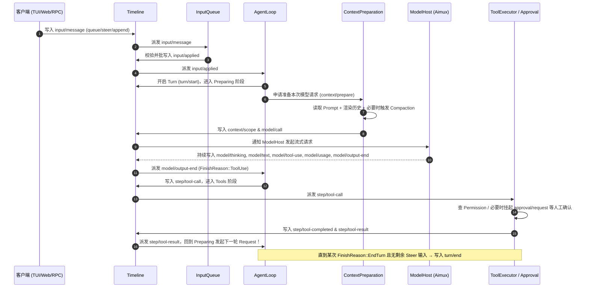

# 第 8 章：回合执行引擎全链路剖析

> **本章目标**：把第 6 章的“事件账本”和第 7 章的“分发器”串联起来，沿着一条真实用户消息，完整走一遍从敲下回车到模型流式吐字、权限审批、工具执行直到回合结束的全链路源码时序。

---

## 8.1 全链路鸟瞰图

当你发出一条消息时，分支内其实有 **7 个核心 Capability** 在按事件节拍精密接力，没有任何一个上帝函数包办一切：



---

## 8.2 第一棒：`InputQueue` —— 接纳、排队、插队与撤回

[`crates/dim-agent-capabilities/src/input_queue.rs`](../crates/dim-agent-capabilities/src/input_queue.rs) 扮演整个分支的“接待前台”：

1. **原始消息只是意图（`input/message`）**：外部提交 `InputMessageData` 时可能附带 `submission_id`（用于客户端幂等去重，重复提交不会写两遍）以及模式 `InputMode`：
   - **`Queue`（默认给用户输入）**：安静排队，等当前 Turn 彻底结束（`turn/end`）后再开新 Turn；
   - **`Steer`（插队纠偏）**：如果 Turn 正在运行，在当前 Request/Tool 边界立刻把这条消息喂给模型；
   - **`Append`（系统/插件附着，默认给纯 `blocks`）**：作为上下文块附着到输入中（如果当前不在跑，行为随边界规则触发或合并）。
2. **准入与生效（`input/applied`）**：`InputQueue` 校验 `UserInput::has_operator_content()` 或 `blocks` 非空、检查交接句柄 `InputHandover`（仅用于模型故障恢复续传），确认合法后才提交 `input/applied`。**从这一刻起，UI 才真正把它算作一条已入队的有效消息。**
3. **撤回与删除（`input/withdraw` -> `input/deleted`）**：只要一条输入还没被 `AgentLoop` 消费（`input/consumed`），用户就能按 `Shift+Left` 或调 `session.input.withdraw` 把它撤回（甚至带一份校验好的替换文案直接转为 `Steer`）。`input/withdraw` 只是请求，只有写出 `input/deleted` 才代表撤回成功。

---

## 8.3 第二棒：`AgentLoop` 状态机

[`crates/dim-agent-capabilities/src/agent_loop.rs`](../crates/dim-agent-capabilities/src/agent_loop.rs) 是回合流转的指挥官，内部围绕三个非常清晰的阶段状态（`enum Stage`）运转：

```text
                ┌──────────────────────────────────┐
                ▼                                  │
   [Idle] ──► Preparing ──► Model ──► Tools ───────┘
                │             │         │
                └──────► 收到 Steer 或 StopInterrupt ◄─────┘
```

- **一个 Turn（回合）包含 1 到多次 Request（模型请求）**：
  - 每次 Request 对应唯一 `request_id`；
  - 每次 Request 按顺序走过 **`Preparing`（准备上下文）→ `Model`（等待模型吐字）→ `Tools`（并发执行工具调用）**。
- **Steer 替换未发出的请求（极细腻的细节）**：
  如果当前 Request 还处在 `Preparing` 阶段（正在做前置准备或压缩，还没真正把 HTTP 请求发给大模型），此时突然进来一条 `Steer` 输入，与其干等旧上下文准备完再多跑一轮，不如直接把旧 Request 标记为 `replaced = true` 取消掉，合并这条 `Steer` 重新准备一次完整的请求！
- **失败自动续传链（`FailureChain`）**：
  如果模型请求因为网络抖动或限流失败，且被 `ModelRecovery` 判定可恢复，它不会粗暴结束 Turn，而是通过 `InputHandover` 与同一份重试预算（`FailureChain`）接力发起下一个 continuation Request。
- **Turn 结束（`TurnOutcome`）**：当模型返回 `end_turn` / `stop_sequence`、且队列里已无待立刻合并的 `Steer` 消息（或者中途被 `StopInterrupt` 取消 / 致命失败）时，写出 `turn/end`。

---

## 8.4 第三棒：`PromptRegistry` 与 `ContextPreparation`

每次 `AgentLoop` 准备发起一次请求前，都会走一遍上下文流水线：

### 1. 模块化 Prompt 组装（`PromptRegistry`）
Dim 的系统提示词不是一块死板的大字符串，而是由各个插件和核心能力按片段注册的：
- 基础编程指导 + 工作区 `AGENTS.md`
- **输入指导（`guideEntries`）**：比如 `Goal`、`EventHub`、`Branch`、`Schedule` 等插件如果往输入里塞了 `<dim-goal ...>`、`<dim-branch-message ...>` 这种运行时标签，可以通过 `guideEntries.register` 注册解释条目，让模型读得懂这些标记的含义（[`Prompt.md`](../docs/design/plugins/Prompt.md)）。
- **Scoped/Keyed `InputBlock::Raw`**：系统注入的运行时提示支持带 `key`（同名块自动以最新一条覆盖旧条，Compaction 压缩时也会自动保留每个活跃 `key` 的最新状态）和 `retire: true`（宣布该状态块退役不再重放）。

### 2. 上下文渲染与 Compaction（自动/手动压缩）
[`crates/dim-agent-capabilities/src/context_preparation.rs`](../crates/dim-agent-capabilities/src/context_preparation.rs) 负责把 Timeline 事件渲染成模型可吃的 `ModelRequest`：
- 读取最近一次 `ProjectionCheckpoint`（压缩检查点）+ 其后的新事件；
- 根据 `ContextPolicy` 判断当前 Token 估算是否触及自动压缩阈值（或用户手动敲了 `/compact`）；
- 若触发压缩，先暂停发送业务模型请求，走一轮 `context/compaction-start` → 摘要生成 → `context/compaction` 写出新的 `ProjectionCheckpoint`，**随后用瘦身后的上下文无痛继续原定任务**！

---

## 8.5 第四棒：`ModelHost` 与 `Aimux` 多协议路由

上下文准备好后，[`crates/dim-agent-aimux`](../crates/dim-agent-aimux/src/lib.rs) 登场。它把各种差异巨大的厂商协议抹平成统一的流式事件：
- 根据当前 Session 选中的 Provider 格式，把统一的 `ModelRequest` 翻译成 **Anthropic Messages / OpenAI Chat / OpenAI Responses / Gemini / Bedrock** 的原生 JSON 载荷；
- 开启请求录制时（`dimcode recording on`），同时把脱敏或原始请求快照写进 `model-log/recordings.jsonl`；
- 在接收 SSE / Stream 流时，为首个 Thinking 块、Text 块预先分配稳定的 `EventDraft.id`，流式持续往 Timeline 追加增量块，最后在收到停止原因时写入 `model/usage`（精确记录输入/输出/缓存命中 Token）和 `model/output-end`。

---

## 8.6 第五棒：工具调用、权限检查与人工审批

当模型在输出中发起了工具调用（`step/tool-call`），就交给 `ToolRegistry`、`ToolExecutor`、`Permission` 和 `Approval` 协同处理：

1. **工具路由（`ToolRegistry`）**：无论是内置的 `WorkspaceTools`（`read`/`write`/`edit`/`glob`/`grep`）、`ShellSession`（`exec`）、`CodeMode`、还是 MCP 工具、亦或 TS/Python/Rust 插件注册的自定义工具，全都在 Session 级统一的 `ToolRegistry` 中注册。
2. **权限前置裁决（`Permission`）**：检查当前 Preset（`read-only` / `workspace-write` / `full-access`）与 Command Rules，以及路径是否超出允许根目录：
   - 允许 → 直接进入执行；
   - 拒绝 → 直接返回拒绝原因的 `ToolResult`；
   - 需要询问 → 交由 `ToolApproval` 发起人工审批！
3. **挂起审批（`Approval`）**：
   - `ToolApproval` 向 Timeline 写入一条 `approval/request`（带唯一 `approval_id` 和调用来源 `BranchSource`）；
   - 所有连接到该 Session 的客户端（TUI 弹窗 / Web 卡片）立刻收到通知；
   - 用户点击允许或拒绝后，客户端调用接口写入 `approval/respond`（或者中途取消写入 `approval/cancelled`）；
   - 工具协程恢复执行，或者把拒绝结果返回给模型。
4. **两条关于工具结果的铁律**：
   - **只有 `ToolResult.content`（字符串）会送给大模型阅读**；`structuredContent`（结构化 JSON）只用于存盘、UI 漂亮渲染和插件内部消费，模型永远看不见 `structuredContent`！
   - 工具结果写回 Timeline 成为 `step/tool-result` 后，`AgentLoop` 立刻把它连同之前模型输出一起打包，进入下一个 `Request` 循环！

---

## 本章小结

回看这一整条链路，你会发现 Dim 没有把执行逻辑写死在一个大函数里，而是让 **`InputQueue`、`AgentLoop`、`PromptRegistry`、`ContextPreparation`、`Aimux`、`Permission/Approval`、`ToolExecutor`** 各司其职、以 Timeline 事实为接力棒。

下一个核心问题来了：**这么多部件，有的活在整个进程里（比如配置和连接管理），有的活在 Session 里（比如工具表），有的活在每条 Branch 里（比如 AgentLoop），它们到底是怎么被安全地组织、注入、又在各自关闭时干净回收的？**

第 9 章，我们揭晓 Dim 的装配骨架——**`rutis` 与单树三层作用域模型**！
