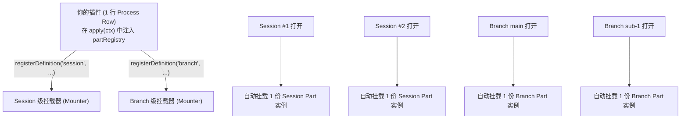

# 第 9 章：插件底座 `rutis` 与单树三层作用域模型

> **本章目标**：吃透 Dim 最具工程含金量的装配底座——`rutis` 微内核如何用一棵四级实例树管理全系统生命周期、如何根据“状态归属”决定代码放哪一层、如何用 `Names::key::<T>()` 与 `PartRegistry` 装配能力，以及跨语言数据面的静态契约保障。

---

## 9.1 为什么需要 `rutis` 单树微内核？

想象一下你在维护一个同时存在以下对象的后台服务：
- 全局共享的 SQLite 数据库、配置管理器、Node/Python 宿主机；
- 多个并发打开的 Session，每个 Session 有自己独立的工作目录、MCP 连接、工具列表；
- 每个 Session 内部又有随时创建、关闭的多条 Branch，每条 Branch 又有各自的 `Timeline`、`Dispatcher` 和一堆运行中的异步后台任务。

如果用普通全局变量 + 手写 `Arc<Mutex<HashMap<...>>>` 去管它们，很快就会遇到三大噩梦：
1. **依赖地狱**：A 插件依赖 B 服务，B 服务热重载了怎么办？
2. **资源泄漏**：关闭一个 Session 时，里面某条分支的 TS 插件还挂着定时器或文件句柄没释放；
3. **跨界乱串**：Branch A 的私有状态被 Branch B 意外读到了。

Dim 用 **`rutis`（0.19.3）** 把整个系统组装成**一棵严格嵌套的生命周期树（Single Instance Tree）**：

```text
process (root)                     <-- App Server 进程级：全局唯一，管存储/设置/会话列表/宿主
 └── agent (instanced)             <-- 智能体配置实例：管装配蓝图与会话创建
      └── session (instanced)      <-- 会话级：管工具注册表/Prompt/工作区/分支树命令
           └── branch (instanced)  <-- 分支级：管 Timeline/Dispatcher/AgentLoop/上下文状态
```

在这棵树里，**父节点一旦关闭或卸载，它的所有子节点以及节点上挂的所有后台任务、监听器、资源清理器（`ctx.effect`）会自动级联安全退出**。

---

## 9.2 黄金法则：状态归谁，代码就放哪一层

无论是读源码还是自己写插件，你都要学会判断一个模块应该放在哪个 Scope（作用域）。记住 [`principles.md`](../docs/architecture/rust-agent/principles.md) 的三条精确语义：

| 作用域 | 代表含义 | 典型核心服务（部分） | 放在这里的典型状态 |
| --- | --- | --- | --- |
| **`process`** | 跨会话、跨重启的全局持久化与外部宿主 | `settings`, `pluginFiles`, `sessions`, `partRegistry`, `managementMethods`, `eventHub` | 插件配置文档、定时任务表、MCP 全局认证、跨会话调度、Web/UI 宿主机 |
| **`session`** | 单次工作对话、一个智能体身份与工作边界 | `sessionIdentity`, `toolRegistry`, `promptRegistry`, `guideEntries`, `treeCommands`, `sessionMethods` | 本会话开放了哪些工具、目录权限边界、子分支树控制权、本地工作区规则 |
| **`branch`** | 单条时间线上的独立行动与折叠状态 | `timeline`, `dispatcher`, `inputQueue`, `agentLoop`, `approval`, `permission`, `branchLine` | 回合状态机、待审批列表、已消耗 Token 统计、当前 Goal 折叠状态 |

### 跨作用域通信的“三向交通规则”
为了防止整棵树变成网状 spaghetti，Dim 对跨作用域访问定了死规矩：
1. **向上注入（合法）**：下层子节点可以按名字直接 `inject` 自己祖先节点提供的服务（例如 `branch` 部件可以直接注入 `session` 的 `toolRegistry` 或 `process` 的 `settings`）。
2. **向下控制（必须经过 `treeCommands`）**：`session` 部件想给某条分支发输入、开分支或中止分支，通过 `treeCommands` 句柄下达命令；**禁止越级把分支私有内部对象暴露给全进程**。
3. **横向兄弟沟通（必须经由共同祖先）**：Branch A 绝对不能直接去读 Branch B 的内存变量！它们之间通信（如发消息、汇报结论），必须通过共同的父级 `session`（例如 `treeCommands` / `BranchMessage`）或者全局 `process` 服务（例如 `sessions` / `eventHub`）中转。

---

## 9.3 一插件一行 + `PartRegistry` 多实例装配机制

你可能会疑惑：*“既然 Session 和 Branch 都是运行时动态打开无数个的，我写的插件怎么同时在 Process 读配置，又能在每个新建的 Session 和 Branch 里自动实例化呢？”*

答案就是 Dim 的 **“一插件一行（One Row Per Plugin）”** 契约（见 [ADR 006](../docs/adr/006-plugin-contract.md) 与 [`crates/dim-agent-runtime/src/parts.rs`](../crates/dim-agent-runtime/src/parts.rs)）：



1. 每个插件（无论是 Rust、TS 还是 Python）在 `process` 层**只作为 1 条 Loader Row 运行一次**；
2. 它向进程服务 `partRegistry` 注册自己想要在 `session` 或 `branch` 作用域挂载的“蓝图”（Rust 注册 `Generator`，TS/Python 注册 `Definition`）；
3. 每当新的 Session 或 Branch 创建时，该节点底下的**两类挂载器（Mounter）**会立刻工作：
   - **Required Mounter（必需挂载器）**：挂载装配清单明确声明“必须就绪才允许对外公开会话”的核心部件（例如 `AgentLoop`、`ConfiguredModel`）。如果其中任何一个失败，整个 Session 创建直接回滚报错！
   - **Optional Mounter（可选挂载器）**：挂载插件和扩展特性。如果某个可选插件报错或挂了，**只影响它自己的功能，绝不会拖垮用户正常打开会话和聊天**！

---

## 9.4 Rust 里的命名与类型安全：`Names::key::<T>()` 与 `Feature`

在纯原生 Rust 中，如果用裸字符串去查服务容易写错类型；如果用静态 Rust TypeId 写死，又没法配合跨作用域动态装配名字（`ServiceCatalog`）。Dim 在 `dim-agent-runtime` 里用了一个两全其美的方案：

1. **目录注册**：每个对外提供服务的类型先通过 `names::register::<T>(catalog, group)` 把“类型 ↔ 服务名（如 `"dispatcher"`、`"timeline"`）”登记进目录；
2. **解析强类型键 `Key<T>`**：在组装插件 `DynPlugin` 时，传入 `&Names` 解析出类型安全的句柄 `Key<T>`：
   ```rust
   // 在构造插件时解析依赖 Key<T>
   let dispatcher: Key<Dispatcher> = names.key::<Dispatcher>()?;
   let counter: Key<Counter> = names.key::<Counter>()?; // 可选或第三方服务同样按类型/名字解析

   // 在 injects() 中声明强类型依赖（告诉 rutis 必须等它们 Active 后才启动我）
   fn injects(&self) -> Vec<TypeKey> {
       vec![self.dispatcher.erase()] // 注意：可选服务绝不放进 injects！
   }

   // 在 apply(ctx) 中安全获取
   let disp = ctx.require_at(&self.dispatcher)?; // 必需服务用 require_at
   let opt_counter = ctx.get_at(&self.counter);  // 可选服务用 get_at（仅在允许缺失时使用）
   ```
3. **高阶封装 `Feature::new`**：对于内置 Rust 特性，还可以直接用流式构建器一键声明跨多个作用域的部件：
   ```rust
   Feature::new("MyFeature")
       .session("MySessionPart", |names| Ok(Box::new(...)))
       .branch("MyBranchPart", |names| Ok(Box::new(...)))
   ```

---

## 9.5 跨语言数据面契约：`#[rutis::service]` 与 `rutis-bridge`

最后，Rust 的高性能内核是如何做到让 **TypeScript（Node.js）** 和 **Python（3.12+）** 插件用起来像原生代码一样顺滑的？

1. **统一标记跨语言服务**：所有准备暴露给 TS/Python 调用的 Rust 服务方法，都在 `impl` 块上标注 `#[rutis::service]`（如 `Dispatcher`、`Timeline`、`Approval`、`TreeCommands` 等）。
2. **宿主桥接连接（`RuntimeConnection`）**：App Server 的 `RuntimeManager` 会启动对应的外部语言运行时进程（Node `session-node` 或 Python `py`），通过 **`rutis-bridge`** 与 Rust 内核建立双向 JSON-RPC/IPC 通道。外部插件里的 `ctx.use("timeline")` 在底层会自动路由成对对应 Rust 对象的异步方法调用！
3. **零漂移类型自动生成**：只要运行 `cargo run --locked -p xtask -- types`，工具就会扫描 Rust 源码里所有标注了 `#[rutis::service]` 的类型和文档注释，自动生成 [`npm/branch-services.d.ts`](../npm/branch-services.d.ts)。因此你在写 TypeScript 插件时，直接 `import type { Services } from 'dimcode/plugin'` 就能享受严苛的 `tsc --strict` 完整类型提示和校验！

> **工程边界提示**：并非所有 Rust 内部对象都跨语言暴露！例如 `before` 同步变换回调、`ModelHost` 流式底层、以及一些仅供进程内通信的结构，故意保持为 Rust-only（`AGENTS.md` 中的“内部数据面”），避免跨 IPC 带来不必要的序列化开销与死锁风险。

---

## 本章小结

现在，Dim 的整个底座已经完全透明：
- **四级单树**（`process -> agent -> session -> branch`）管生老病死；
- **状态归属决定作用域**，三向规则杜绝乱串；
- **`PartRegistry`** 让“一插件一行”优雅衍生到无数个会话和分支；
- **`#[rutis::service]` + `xtask types`** 打通 Rust / TypeScript / Python 三界契约。

从下一章起，我们正式进入**第三篇：二次开发与工程实战**，卷起袖子开始写代码！
