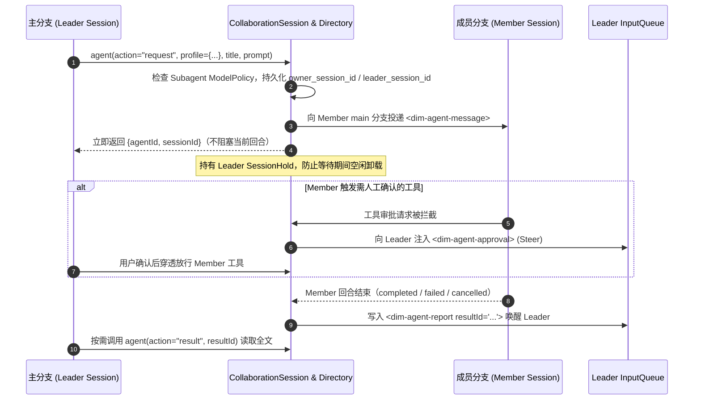
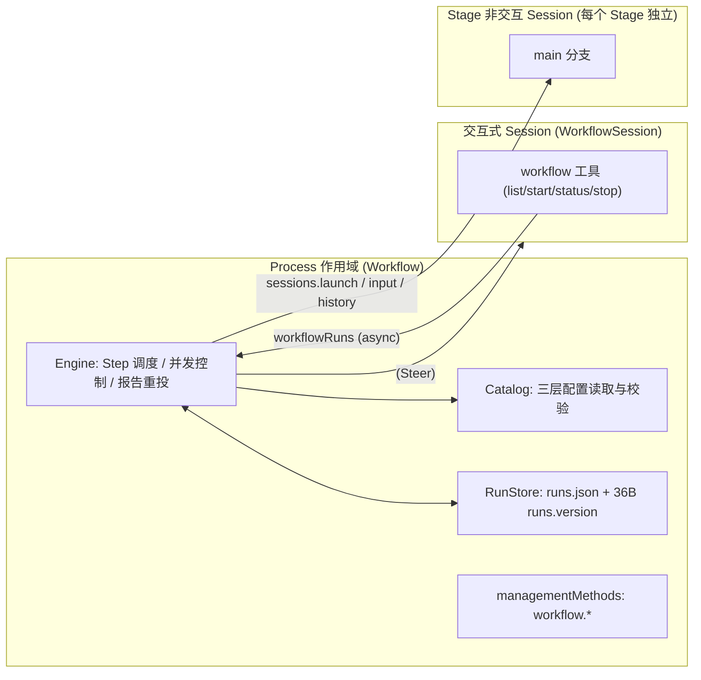

# 第 14 章：专题进阶 —— 多 Agent 协作与动态工作流（Dynamic Workflow）实战

> **本章目标**：吃透 Dim 中实现复杂任务分解与自动化编排的**三层核心机制**（`branch` 时间线分叉、`agent` 多 Agent 团队协作、`@dimcode/workflow` 结构化工作流引擎）——既看懂它们底层的状态机、事件总线、权限天花板与崩溃恢复原理，又能马上在日常开发与二次开发中用起来。

---

## 14.1 全景定位：Dim 的三层编排武器库

在传统 Agent 框架里，“多 Agent”和“Workflow”常常被混成一团。而在 Dim 中，复杂任务的拆分与编排被清晰地拆成三个正交层次：

| 维度 | `branch`（时间线分叉） | `agent` / Collaboration（多 Agent 团队） | `workflow`（`@dimcode/workflow` 插件） |
| --- | --- | --- | --- |
| **核心隐喻** | **同一个你**分头探索 | **Leader + 多个专业下属**组队协作 | **标准化流水线 / DAG 阶段引擎** |
| **核心实现** | [`crates/dim-agent-capabilities/src/timeline_tree.rs`](../crates/dim-agent-capabilities/src/timeline_tree.rs) | [`crates/dim-app-server/src/collaboration.rs`](../crates/dim-app-server/src/collaboration.rs) | [`runtime/plugins/workflow/`](../runtime/plugins/workflow/README.md) |
| **上下文隔离** | 零拷贝共享分叉点之前的祖先对话，之后各自演进 | **全新独立 Session**，只看得到指派任务与自身执行过程 | **每个 Stage 独立非交互 Session**，仅通过 `{{stages.<id>.result}}` 传下游 |
| **角色与工具定制** | 与主线完全一致 | 支持复用持久化 Agent 或**现场动态传 `profile`** 定制 | 每个 Stage 可选指定 `agent` 与 `model` |
| **动态性（Dynamic）** | 运行期由模型自主 `create` / `message` / `end` | **强动态**：主模型思考中随时决定招几个专家、配什么工具/模型、何时 `steer` 改向 | **模板参数化 + 可编程写入**：`{{params.*}}` 与阶段产物拼接，或通过 `workflow.save` 动态生成定义再运行 |
| **崩溃与重启恢复** | 依赖 `Timeline` 祖先事件重放 | 依赖 SQLite 所有权外键 + `collaboration/*` 事件 | 持久化在 `workflow/runs.json`（v2），重启后幂等重投 `pending` 报告 |

用一句话总结“**什么是 Dim 里的 Dynamic Workflow**”：
1. **如果你需要完全无预设图结构的“运行时动态编排”**：主 Agent 利用 `agent(action: "request", profile: ...)` + `branch(action: "create")` 在执行过程中**动态生成拓扑**；
2. **如果你需要可持久化、可复用、跨步骤并行扇出与结果接力的“结构化工作流”**：使用 `@dimcode/workflow` 引擎（或让调度器通过 `workflow.save` + `workflow.start` 动态生成并触发 `dim.workflow/v1` 定义）。

---

## 14.2 深度拆解一：多 Agent 团队协作（Collaboration）

Dim 的多 Agent 设计刻意拒绝“任意嵌套套娃”和“后台直接偷改彼此内存”，而是建立了一套**单层星型团队 + Timeline 事件驱动唤醒**模型（设计契约见 [`docs/design/plugins/Collaboration.md`](../docs/design/plugins/Collaboration.md)）。

### 1. 整体协作时序



### 2. Leader 与 Member 的非对称工具集（防套娃铁律）
查看 [`crates/dim-app-server/src/collaboration.rs`](../crates/dim-app-server/src/collaboration.rs) 中的 `agent_definition`，同一个 `agent` 工具在两种角色下暴露的 Schema 完全不同：

| 角色 | 允许的 `action` | 关键设计意图 |
| --- | --- | --- |
| **Leader（主会话）** | `request`、`cancel`、`close`、`message`、`read`、`list`、`inspect`、`result`、（可选）`models` | 全权负责拉人、派活、纠偏、查看进度、拉取完整结果与清理成员 |
| **Member（成员会话）** | **仅 `message`、`read`、`list`** | **物理禁止 Member 再调用 `request`**！确保团队永远只有“Leader → Members”一层，彻底消灭无限递归委派与失控扇出 |

### 3. 现场动态定制：`profile` 与 Owned Agent 生命周期
Leader 在 `request` 时有两种派活方式：
- **指派公共 Agent**：传入通过 `agent(action="list")` 拿到的不透明 `agentId`（注意：如 `"default"` 这样的名称不是 `agentId`）。
- **现场动态捏临时 Agent**：直接传 `profile` 对象，为这个子任务临时定制专属系统提示、工具白名单和模型：

```json
{
  "action": "request",
  "title": "Audit SQLite migration safety",
  "prompt": "只读检查 crates/dim-app-server/src/storage 的迁移逻辑，确认是否存在锁表或破坏性变更。",
  "profile": {
    "name": "migration-auditor",
    "description": "Read-only SQLite migration reviewer",
    "systemPrompt": "你是只读数据库审计专家，只能检查与分析，禁止修改文件。",
    "tools": ["read", "grep", "glob"],
    "model": {
      "providerId": "anthropic",
      "modelId": "claude-sonnet-4-20250514"
    }
  }
}
```

背后的数据库与生命周期硬约束非常严谨：
- **Owned Agent 隔离**：用 `profile` 创建出的临时 Agent 带有 `agents.owner_session_id = <leader_session_id>`，其创建的 Member Session 带有 `agent_sessions.leader_session_id = <leader_session_id>`。其他团队和公共 RPC `agent.list` 完全看不到它。
- **禁止分叉 Member**：对 Member Session 调用 `session.fork` 会被直接拒绝，因为 Fork 出来的会话既没有 Leader 归属又残留成员角色。
- **级联删除**：当用户删除 Leader Session 时，系统会先逐个清理 Member Session 的记录，再关闭并删除所有 Owned Agent，最后删除 Leader 自身。

### 4. 异步并发、抗上下文膨胀与跨会话审批
1. **非阻塞并发**：`agent(action="request")` 只要把任务写进 Member 的 `InputQueue` 就立刻返回 `{agentId, sessionId}`。Leader 可以在同一个模型回复里一口气连续发起 3~5 个 `request`，让多个专家并行工作。
2. **六个核心 Timeline 事实**：Collaboration 会在 Leader 分支的 `Timeline` 中记录标准的 `collaboration/request`、`collaboration/delivered`、`collaboration/message`、`collaboration/cancel`、`collaboration/close` 和 `collaboration/result`（见 [`crates/dim-agent-types/src/events.rs`](../crates/dim-agent-types/src/events.rs)），崩溃重启后 `CollaborationTimeline` 通过 `dispatcher.consume` 重建挂起请求表。
3. **预览 + `resultId` 懒加载**：Member 结束后，Coordinator 只把**带有限字符预览和 `resultId` 的 `<dim-agent-report>`** 塞进 Leader 队列；同时通过 `GuideEntries` 告诉模型“若需完整内容请调 `agent(action="result", resultId)`”。这样即使子 Agent 吐出 50 KB 日志，也不会瞬间把 Leader 上下文撑爆。
4. **跨会话工具审批桥接（[`approvals.rs`](../crates/dim-app-server/src/collaboration/approvals.rs)）**：Member 后台执行高危操作被 Permission 拦住时，系统用 SHA-256 计算确定性 `approvalId`，将 `<dim-agent-approval>` 以 `Steer` 模式投递回 Leader；用户批准后再穿透放行 Member，审批结束再发 `<dim-agent-approval-ended>` 收尾。

---

## 14.3 深度拆解二：结构化工作流引擎（`@dimcode/workflow`）

当你的多步骤流程需要**固定顺序、并行扇出、参数化复用、结果管道接力、且要求崩溃后可审计可恢复**时，应当使用位于 [`runtime/plugins/workflow/`](../runtime/plugins/workflow/README.md) 的 TypeScript 官方工作流插件（契约见 [`docs/design/plugins/Workflow.md`](../docs/design/plugins/Workflow.md)）。

### 1. 插件架构：两层作用域各司其职



- **Process 插件（`index.ts`）**：全局唯一实例，管理配置目录 `Catalog`、执行引擎 `Workflow`（`engine.ts`）、持久化 `RunStore`（`store.ts`），并对外注册 `workflow.*` 管理 RPC（`list` / `save` / `start` / `status` / `stop`）和 `partRegistry` 会话部件定义。
- **Session 插件（`session.ts`）**：由每个 Session 自动挂载为 `WorkflowSession`，通过依赖 `workflowRuns` 转发调用，并注入 `<dim-workflow>` 的 `GuideEntries`（`order: 120`）。在非交互式 Session（比如 Stage 自己的 Session）中，Handler 会硬拒绝执行 `workflow` 工具，避免套娃死循环。

### 2. 三层定义来源与覆盖优先级
[`catalog.ts`](../runtime/plugins/workflow/catalog.ts) 支持从三个来源加载 `dim.workflow/v1` 定义，同名生效优先级从高到低为：
1. **已启用的项目级定义（`project`）**：存放在 `<cwd>/.dimcode/workflows/<name>.yaml`。**遵循 ADR 003 安全铁律：项目里的工作流默认处于禁用状态**，必须在用户本地 Settings 的受保护字段 `projectEnabled[canonicalCwd][name]` 中显式启用才能运行，防止拉取陌生 Git 仓库时被恶意工作流越权执行。
2. **用户级定义（`user`）**：存储在 Settings 源 `workflow`（`workflow.json`）的 `definitions` 字段中，天然启用。
3. **插件包自带定义（`plugin`）**：随扩展包打包附带的只读定义。

### 3. 步进执行、动态模板渲染与 A17 权限封顶
来看 [`engine.ts`](../runtime/plugins/workflow/engine.ts) 和 [`definition.ts`](../runtime/plugins/workflow/definition.ts) 的核心调度细节：
- **Steps 约束**：一个定义最多 32 个 Step；每个 Step 要么是单个 `stage`，要么是包含 **2~8 个 Stage** 的 `parallel` 数组；`max_concurrent_runs` 与单 Run 的 `max_concurrent_stages` 默认均为 `4`。
- **动态变量替换（`render()`）**：
  - `{{params.<name>}}`：传入参数（必填缺失或未声明参数均在启动前被 `parameters()` 拒绝）；
  - `{{stages.<prev_stage_id>.result}}`：**把前面已经 `completed` 的 Stage 输出结果动态注入后续 Stage 的 Prompt**！但严禁引用同一步 `parallel` 中的兄弟 Stage 结果。
  - **整步防半拉子校验**：执行并行 Step 前，先对全部兄弟渲染 Prompt；只要任意一个超出 **32 KiB**，整步立即失败，**不会启动任何兄弟 Session**。
- **A17 权限天花板锁定**：运行第一个 Stage 时，把 `starter` 与请求 `policy` 传给 `sessions.launch`；宿主返回的真实 `policy` 会被写死在 `run.policy_cap` 中，之后本 Run 所有 Stage 均不得突破该权限上限（由 `managementMethods` 无发起会话直接启动时，默认封顶 `ReadOnly`）。

### 4. 存储优化、帧边界保护与崩溃恢复
跨语言（Rust ↔ Node）桥接单帧限制为 16 MiB，Workflow 做了极其克制的边界设计与性能工程：
- **36 字节变更令牌（`workflow/runs.version`）**：每个运行中的 Stage 每秒要轮询一次状态/停止标记（`pause()` 1 秒）。为了不每秒反序列化几 MB 的 `runs.json`，`RunStore` 每次写入成功后都会顺带刷新一个 36 字节的 UUID 令牌文件 `workflow/runs.version`；轮询时优先读 36 字节令牌，仅当令牌变化时才读取完整 Store！
- **严格容量上限**：单条定义压缩 JSON ≤ 1 MiB；单个桥接 Payload / `workflow.json` ≤ 8 MiB；单 Stage 结果文本 ≤ 64 KiB；单个 Run 累计存储结果 ≤ 512 KiB；单条日志/原因 ≤ 512 B；超过上限时 `retain()` 会自动淘汰较早的已结算终态 Run（保留活跃 Run、待投递报告及最近 100 条历史）。
- **崩溃恢复与报告幂等投递**：重启调用 `restore()` 时，未结束的 `launching`/`running` Stage 转为 `lost (owner_interrupted)`，Run 转为 `interrupted`；而只要 Run 产生需要汇报的终态（`completed` / `failed` / `interrupted`），其 `report` 记录会携带唯一 `submission_id: "workflow:<uuid>"` 置为 `pending`，即便进程重启也会自动重试投递 `<dim-workflow kind="report">`（Steer），目标分支保证按 `submissionId` 严格去重只收一次。

---

## 14.4 实战指南一：用好“多 Agent 动态编排”

### 1. 日常自然语言驱动动态团队
在交互式终端中，你不需要写任何配置文件，只需直接下达包含角色分工与并发要求的任务指令：

```text
请并行派 3 个子 Agent 帮我审计这次重构，最后由你汇总：
1. 架构审计员（只读工具）：检查 crates/dim-agent-runtime 的公共 API 是否破坏边界；
2. 性能分析员（只读工具）：检查 timeline.rs 和 dispatcher.rs 是否有不必要的全量克隆；
3. 文档核对员（只读工具）：核对 book/06 与 book/07 里写的类型名和源码是否一致。
```

主 Agent 会自动走通：
`models` / `list` → 连续 3 次 `agent(action="request", profile=...)` → 等待 `<dim-agent-report>` 唤醒 → 按需 `result` 拉取完整报告 → 给出统一汇总。

### 2. 控制子 Agent 成本与人工介入
- **统一限制子 Agent 模型**：在 TUI 的模型面板中配置 Subagent Model Policy（对应 RPC `collaboration.set_model_policy`），防止主模型随手给 5 个子 Agent 全都分配高价旗舰模型。
- **后台任务监控与精准止损**：
  - 在 TUI 后台任务视图里可以直接查看每个成员的短标题（`title`）与运行状态；
  - 发现某个子 Agent 理解有偏差时，直接让主 Agent 发 `agent(action="message", mode="steer", ...)` 实时扭转方向；
  - 若需强行中止单个成员而保留主线，客户端可调用 `session.collaboration.cancel`（未消费直接从队列撤回，已消费则只打断该成员当前回合）。

---

## 14.5 实战指南二：安装、编写与运行 Dynamic Workflow

### 1. 安装并激活 `@dimcode/workflow` 插件
根据 [`runtime/default-plugins.json`](../runtime/default-plugins.json) 与 [`runtime/plugins/workflow/README.md`](../runtime/plugins/workflow/README.md)，**默认的 `./dev` 与基础发行包不会预装 Node 运行时与 Workflow 插件**，使用前请按下面步骤显式安装一次：

```bash
# 1. 在源码仓库构建 runtime 与 workflow 插件依赖
npm ci --prefix runtime --ignore-scripts
npm ci --prefix runtime/plugins/workflow --ignore-scripts
(cd runtime && npm install --no-save --package-lock=false --ignore-scripts --install-links ./plugins/workflow)

# 2. 安装 Node 运行时（若使用 ./dev 调试，请将 dimcode 替换为 ./dev 或先安装好隔离运行时）
dimcode runtime install node

# 3. 显式安装并启用 workflow 插件（必须使用绝对路径）
dimcode plugin install /home/yj/github.com/yangjuncode/dim/runtime/plugins/workflow --id workflow
```

> 安装后如果发现工具暂未就绪，可以用 `dimcode plugin list` 检查 `workflow` 行是否处于 `Active` 状态（在 Node 未安装前该行会保持 `Pending`）。

### 2. 编写一个多阶段并行 + 结果接力 YAML（`review-pipeline.yaml`）
把下面文件保存为项目内 `.dimcode/workflows/review-pipeline.yaml`：

```yaml
schema: dim.workflow/v1
name: review-pipeline
description: 并行安全与架构审查，随后汇总修复建议
policy: read_only
parameters:
  - name: target
    description: 待审查的 crate 或目录路径
    required: true
  - name: focus
    description: 额外关注点
    required: false
    default: "并发安全与边界校验"

steps:
  # 第一步：两个专家 Stage 并行运行在各自隔离的非交互 Session 中
  - parallel:
      - id: security
        prompt: |
          对 {{params.target}} 进行只读安全审计，重点关注输入校验与权限边界。
          额外关注点：{{params.focus}}
      - id: architecture
        prompt: |
          对 {{params.target}} 进行只读架构评审，检查模块分层与错误处理。
          额外关注点：{{params.focus}}

  # 第二步：动态引用上面两个并行阶段的输出产物
  - stage:
      id: synthesize
      prompt: |
        请合并以下两份独立审计结果，按风险等级给出可执行修复清单：

        [安全审计]
        {{stages.security.result}}

        [架构评审]
        {{stages.architecture.result}}
```

### 3. 三种启动与集成方式

#### 方式 A：使用 `dimcode workflow` CLI 管理命令（[`args.rs`](../crates/dim-cli/src/args.rs)）
```bash
# 1. 列出当前全部工作流定义及有效性校验结果
dimcode workflow list

# 2. 项目目录 .dimcode/workflows/review-pipeline.yaml 默认禁用，需显式启用：
dimcode workflow enable review-pipeline

#    （可选）如果是从 JSON 添加到用户级配置，add 命令接收 {"source":"user","document":{...}}：
#    dimcode workflow add ./add-review-pipeline.json
#    或用 set 直接写入某个用户级工作流文档 JSON：
#    dimcode workflow set review-pipeline ./review-pipeline.json

# 3. 准备参数文件 params.json: {"target": "crates/dim-app-server"} 并启动
dimcode workflow start review-pipeline ./params.json

# 4. 查看近期运行历史与状态
dimcode workflow history review-pipeline
```

#### 方式 B：在对话中让主 Agent 自动调度 `workflow` 工具
在交互式对话中直接告诉它：
> 「查看有哪些可用的 workflow，并用 `target=crates/dim-agent-runtime` 启动 `review-pipeline`。」

主 Agent 会调用 `workflow(action="list")` → `workflow(action="start", name="review-pipeline", params={"target": "crates/dim-agent-runtime"})`，拿到 `run_id` 后先挂起等待；所有 Stage 跑完后，`<dim-workflow kind="report">` 会自动以 `Steer` 唤醒主 Agent，它再按需调用 `workflow(action="status", run_id=...)` 整理细节回复给你。

#### 方式 C：外部系统“动态生成定义 + 触发执行”
如果你在自研 CI/研发平台中希望每次根据 PR 变更动态拼装不同的并行检查步骤，可以通过 App Server 管理 RPC 串联：
1. 调用 `workflow.save`（传入 `{ source: "user", document: { schema: "dim.workflow/v1", ... } }` 或 `{ source: "project", cwd, document }`）；
2. 紧接着调用 `workflow.start`（传入 `name`、`cwd`、`params`，可选 `report_to: { session_id, branch_id }` 把最终报告推回指定会话）。

---

## 14.6 实战决策速查表

| 你遇到的问题 | 应该选什么 | 关键原因 |
| --- | --- | --- |
| 想顺手并行试两种改法，但不想丢掉刚才聊了 20 轮的上下文 | **`branch`** | 零拷贝继承父时间线，切分即走 |
| 想让 3 个不同专业提示词/不同权限工具/不同模型的子 Agent 并行调研，且主 Agent 随时可纠偏 | **`agent`（Collaboration）** | 动态 `profile` + 单层星型团队 + 跨会话审批桥接 |
| 流程节点清晰、需要并行扇出与 `{{stages.*.result}}` 管道传递、追求崩溃可恢复与可复用 | **`workflow`** | Schema 强校验 + A17 权限封顶 + `runs.json` 持久化与幂等报告 |

---

## 本章小结

`branch` 解决了**同源思想的并行分叉**，`Collaboration` 解决了**异构多 Agent 的动态组队**，而 `@dimcode/workflow` 解决了**结构化流水线的可靠编排与恢复**。三者全部建立在 Dim 统一的 `Timeline` 与 `InputQueue` 原语之上，相互独立又可组合使用（例如在交互会话里由主 Agent 发起一条 Workflow，或者用多 Agent 团队探索出最优流程后再固化为 `dim.workflow/v1` YAML 长期复用）。
