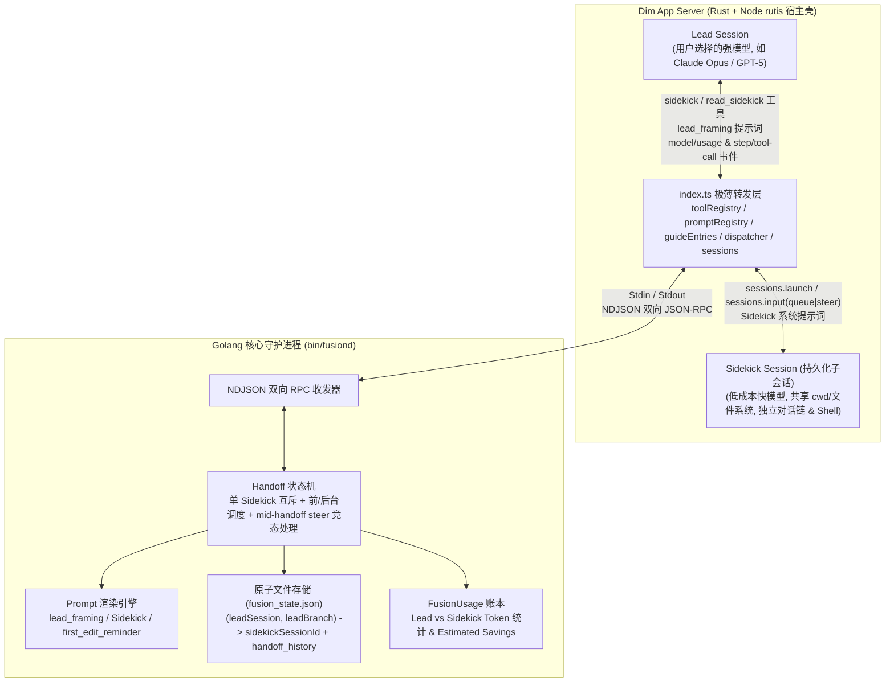

# 第 15 章：专题实战 —— 用 Golang 编写 Dim 插件实现 Devin Fusion

> **本章目标**：结合 [`devin-cli-fusion-research.md`](./devin-cli-fusion-research.md) 的逆向研究成果，从零构建一个以 **Golang 为核心引擎**的 Dim 插件 **`dim-plugin-fusion`**，完整复现 Devin CLI Local Fusion 的核心体验：**Lead（前沿强模型） + Sidekick（低成本持久执行子代理）双角色协同、跨轮持久上下文、前/后台 handoff 状态机、运行中 mid-handoff 转向注入、行为引导与纠偏、以及 Fusion Savings 用量账本**。

---

## 15.1 Dim 对 Golang 插件的支持现状与架构选型

在动手写代码之前，必须先搞清楚一个核心问题：**Dim 的插件加载器原生支持直接加载 `.go` 或 Go 编译产物吗？**

查阅 [`crates/dim-app-server/src/plugin_manager.rs`](../crates/dim-app-server/src/plugin_manager.rs#L121-L137) 与 [`crates/dim-app-server/src/plugin_manager/record.rs`](../crates/dim-app-server/src/plugin_manager/record.rs#L319-L347) 可以确认：
- Dim 当前的 `rutis-loader` 仅内置了 **Node（TypeScript/JavaScript）** 和 **Python（`.py`）** 两种脚本代码运行时（`code.entry` 仅识别 `.py` 与 Node 模块），**目前没有原生的 Go `rutis` 语言运行时**。
- 一个标准插件根目录的 [`dim-plugin.json`](../docs/design/plugins/PluginManager.md) 允许声明 5 类载荷：`code`（`rutis` 宿主代码）、`skills`、`mcp`、`hooks`、`ui`（注意 `ManifestFile` 使用了 `#[serde(deny_unknown_fields)]`，不能随意写未定义字段）。

那么，**如何用 Golang 为 Dim 开发高复杂度的插件？** 工程上有两条成熟路线：

| 方案 | 架构形态 | 能接入的 Dim 能力 | 适用场景 |
| :--- | :--- | :--- | :--- |
| **路线 A：纯 Go MCP Server** | `dim-plugin.json` 声明 `"mcp": "mcp.json"`，直接拉起 Go 二进制 | 仅暴露 MCP Tools / Resources / Prompts | 无状态工具、数据库/API 查询器、外部服务封装 |
| **路线 B：Go 核心引擎 + 极薄 TS 宿主壳（本章采用）** | Go 编译为常驻子进程 `bin/fusiond`，仅用 ~160 行 `index.ts` 做 `rutis` 服务总线转发 | **全部原生能力**：`sessions`、`promptRegistry`、`toolRegistry`、`guideEntries`、`settings`、`managementMethods`、`dispatcher` | **Devin Fusion**、状态机编排、跨会话路由、用量监控等深度运行时扩展 |

### 为什么实现 Devin Fusion 必须选路线 B？

对照 [`devin-cli-fusion-research.md`](./devin-cli-fusion-research.md) 的研究结论，Devin Fusion **绝不只是多了一个工具**，它至少依赖 **5 项 Dim 内部运行时能力**，这些都是纯 MCP Server 无法触达的：
1. **`sessions` 服务**：拉起独立模型、独立对话链但共享工作目录的 Sidekick Session（`sessions.launch`），并向其投递 Queue/Steer 输入（`sessions.input`）。
2. **`promptRegistry` 服务**：在 Branch 作用域动态注入 `delivery: 'system'` 的 `lead_framing`（告诉 Lead 它有一位持久 Sidekick）以及 Sidekick 专属系统提示词。
3. **`guideEntries` 服务**：向模型解释插件写入的 `<fusion-sidekick-report>` 等自定义 XML 标记语义。
4. **`dispatcher` 服务**：实时消费 `model/usage` 与 `step/tool-call` 事件，实现 Lead 越权直接改代码的纠偏提醒，以及 Lead vs Sidekick 的精确费用核算。
5. **`settings` + `managementMethods`**：持久化 Fusion Preset（Lead/Sidekick 模型搭配、单价表、策略开关），并对 TUI / CLI / Web 客户端暴露 `fusion.status` 等 RPC 接口。

因此，**“Go 核心守护进程（`fusiond`） + 极薄 TS 胶水壳（`index.ts`） + Stdin/Stdout NDJSON 双向 RPC”** 是在 Dim 中发挥 Golang 强项（并发状态机、类型安全、零运行时依赖的单二进制分发）的最优工程架构。

---

## 15.2 解构 Devin Fusion：从研究报告到 Dim 映射蓝图

把 [`devin-cli-fusion-research.md`](./devin-cli-fusion-research.md) 中的核心设计逐项映射到 Dim 的实体模型上，你会发现惊人的契合度：



对照研究报告的每一个关键机制，我们在插件中做出如下精确实现：

| Devin Fusion 原版机制（研究报告章节） | `dim-plugin-fusion` 中的 Dim + Go 对应实现 |
| :--- | :--- |
| **Lead / Sidekick 角色分离**（§一、§4.2、§4.3） | Lead 保持用户当前交互会话；Sidekick 是由 `sessions.launch` 创建的 `origin: 'automation'` 独立 Session，共享 `cwd`（共享文件系统与 Git 仓库），但拥有独立的时间线与 Bash 工具环境。 |
| **`subagent_heads` 持久化链**（§4.5） | Go 状态库维护 `(leadSessionId, leadBranchId) -> sidekickSessionId` 映射与 `handoff_history`（对标 `handoff_history.rs`，保留最近 N 条逐字记录 + 早期摘要），多次 handoff 持续复用同一个 Sidekick，无需重复建链。 |
| **`local_fusion/lead_framing` COG**（§4.2、附录 A.1） | 利用 Dim 的 `promptRegistry`，在 `target.scope.kind === 'branch'` 时，向 Lead 注入 `## Sidekick` 系统提示词，向 Sidekick 注入 `You are the Sidekick subagent...` 系统提示词。 |
| **`sidekick` 工具与状态机**（§4.4、附录 A.2） | 注册 `sidekick`（`task`, `block`）与 `read_sidekick`（`block`, `timeout_ms`）：<br>1. `block: true`（默认）：Go 阻塞等待该轮 handoff 完成并直接返回报告；<br>2. `block: false`：立即返回受理回执，完成后 Go 反向调用 `host/send_input` 向 Lead 注入 `<fusion-sidekick-report>`；<br>3. **运行中再次调用 `sidekick`**：绝不启动第二个 Sidekick，而是调用 `sessions.input({ mode: 'steer' })` 注入 mid-handoff brief；若注入瞬间 Sidekick 恰好结束，Go 捕获竞态并按新任务接力重发。 |
| **`guidance.rs` 行为纠偏**（§4.7、附录 A.4） | Branch 级消费 `step/tool-call`：若开启 Fusion 的 Lead 在尚未委派过 Sidekick 时直接调用 `write` / `edit` 等文件修改工具，在后续输入中注入 `first_edit_reminder`。 |
| **`FusionPricing` & `FusionUsage`**（§4.8） | Branch 级消费 `model/usage`（注意 Dim 的 `Usage` 字段为 `camelCase`：`promptTokens`、`completionTokens`、`cacheReadTokens`、`cost`），Go 按 Lead / Sidekick 分别记账，实时计算 **Estimated Fusion savings**（对比“全用 Lead 模型”的估算节省）。 |

---

## 15.3 工程目录与双向通信协议设计

### 1. 插件目录结构

在独立工作目录（例如 `/tmp/dim-plugin-fusion`）创建如下 Go + TS 混合插件工程：

```text
dim-plugin-fusion/
├── dim-plugin.json              # Dim 插件清单（严格遵循 ManifestFile 白名单字段）
├── package.json                 # Node/TS 依赖声明（@arcships/rutis）
├── index.ts                     # 极薄 TypeScript 宿主壳（~160 行，零业务逻辑）
├── go.mod                       # Golang 模块声明（纯标准库，零外部依赖！）
├── cmd/
│   └── fusiond/
│       └── main.go              # Go 守护进程入口与 NDJSON 双向 RPC 调度器
├── internal/
│   └── fusion/
│       ├── types.go             # 协议帧、Preset、State、Usage 结构体定义
│       ├── store.go             # 原子持久化存储（Bindings + HandoffHistory + Ledger）
│       ├── prompts.go           # Lead / Sidekick 系统提示词与 guidance 模板
│       └── engine.go            # Local Fusion 核心状态机与用量核算引擎
└── bin/
    └── fusiond                  # `go build` 产出的静态/单文件二进制（随插件分发）
```

> **为什么 Go 侧零外部依赖？**  
> 本章刻意只使用 Go 1.22+ 标准库（`encoding/json`、`bufio`、`context`、`sync`、`os`、`time`）编写整个 `fusiond`。好处是任何读者只要装了 Go 工具链就能 `go build` 零报错编译，且通过 `CGO_ENABLED=0` 编译出的 `bin/fusiond` 可以在目标机器上免装 Go 环境直接运行！

### 2. 编写 `dim-plugin.json` 与 `package.json`

首先创建 `dim-plugin.json`。对照 [`crates/dim-app-server/src/plugin_manager/record.rs`](../crates/dim-app-server/src/plugin_manager/record.rs#L319-L347) 与 [`runtime/plugins/workflow/dim-plugin.json`](../runtime/plugins/workflow/dim-plugin.json)，`code` 必须使用 `camelCase` 并声明进程级需要注入的服务：

```json
{
  "name": "fusion",
  "version": "0.1.0",
  "description": "Devin-style Local Fusion (Lead + persistent Sidekick) implemented in Golang",
  "dependencies": "npm",
  "code": {
    "entry": "index.ts",
    "inject": [
      "sessions",
      "settings",
      "pluginFiles",
      "partRegistry",
      "managementMethods",
      "processActivity"
    ],
    "provides": {},
    "config": {}
  }
}
```

配套的 `package.json`（与宿主固定的 `@arcships/rutis` 版本 `0.19.3` 对齐，参考 [`runtime/plugins/workflow/package.json`](../runtime/plugins/workflow/package.json)）：

```json
{
  "name": "@dim-community/fusion",
  "version": "0.1.0",
  "private": true,
  "type": "module",
  "exports": "./index.ts",
  "dependencies": {
    "@arcships/rutis": "0.19.3"
  },
  "devDependencies": {
    "@types/node": "24.10.0"
  }
}
```

### 3. 双向 NDJSON JSON-RPC 协议设计

Go 进程 `fusiond` 由 `index.ts` 通过 `child_process.spawn` 启动，两者通过 **Stdin / Stdout 的按行分隔 JSON（NDJSON）** 通信（`stderr` 留给 Go 打诊断日志，App Server 会收集到插件日志流中）。

由于既需要 **Host 调 Go**（如触发一次 handoff、获取系统提示词、上报事件），也需要 **Go 反向调 Host**（如让 Dim 拉起 Sidekick Session、投递 Steer 输入、给后台完成的 Lead 发汇报），协议设计成**全双工 RPC 帧**：

```json
// 请求帧（dir: Host->Go 或 Go->Host）
{"id": 1, "method": "fusion/handoff", "params": {...}}

// 响应帧（匹配同一 id）
{"id": 1, "result": {...}}
// 或错误响应
{"id": 1, "error": {"code": "handoff_failed", "message": "..."}}

// 单向通知帧（无 id，用于异步日志/事件上报）
{"method": "fusion/event", "params": {...}}
```

两端的接口契约一目了然：
- **Host → Go 方法**：
  - `fusion/init`：传入插件数据目录与初始配置，加载持久化状态。
  - `fusion/prompt`：查询某个 `(sessionId, branchId)` 应挂载的 `Lead` 或 `Sidekick` 系统提示词。
  - `fusion/handoff`：执行 `sidekick{task, block}` 工具调用。
  - `fusion/read`：执行 `read_sidekick{block, timeout_ms}` 工具调用。
  - `fusion/status`：查询指定或全部 Lead 会话的 Fusion 绑定、历史轮次与 `FusionUsage / Estimated Savings`。
  - `fusion/event`（通知）：推送 Branch 上的 `model/usage` 与 `step/tool-call` 事件。
- **Go → Host 反向方法（Host Capability RPC）**：
  - `host/launch_session`：调用 Dim `sessions.launch` 创建持久化 Sidekick Session。
  - `host/send_input`：调用 Dim `sessions.input`（支持 `queue` / `steer`）。
  - `host/history`：调用 Dim `sessions.history` 读取 Sidekick 最近回合并提取最终报告文本。

---

## 15.4 实战编写 Golang 核心引擎（`fusiond`）

初始化 Go 模块：

```bash
mkdir -p /tmp/dim-plugin-fusion/{cmd/fusiond,internal/fusion,bin}
cd /tmp/dim-plugin-fusion
go mod init github.com/dim-community/dim-plugin-fusion
```

### 第 1 步：`internal/fusion/types.go`（核心数据模型）

这里把 Devin Fusion 的核心概念全部强类型化：Preset、模型定价、会话绑定、Handoff 历史记录、以及 `FusionUsage` 账本。

```go
package fusion

import "encoding/json"

// ModelID 对应 Dim 的 ModelId { providerId, modelId }
type ModelID struct {
	ProviderID string `json:"providerId"`
	ModelID    string `json:"modelId"`
}

// ModelPricing 记录每百万 Token 的估算价格（USD），用于计算 Estimated Fusion savings
type ModelPricing struct {
	InputPerMillion     float64 `json:"inputPerMillion"`
	OutputPerMillion    float64 `json:"outputPerMillion"`
	CacheReadPerMillion float64 `json:"cacheReadPerMillion"`
}

// Preset 定义一组 Lead + Sidekick 配对策略（对标 Devin /fusion picker）
type Preset struct {
	ID               string       `json:"id"`
	Label            string       `json:"label"`
	LeadModel        *ModelID     `json:"leadModel,omitempty"`
	SidekickModel    ModelID      `json:"sidekickModel"`
	Effort           string       `json:"effort"`           // low | medium | high
	FastMode         bool         `json:"fastMode"`
	BroadExploration bool         `json:"broadExploration"` // 对标 DEVIN_LOCAL_FUSION_BROAD_EXPLORATION
	LeadPricing      ModelPricing `json:"leadPricing"`
	SidekickPricing  ModelPricing `json:"sidekickPricing"`
}

// SettingsDocument 对应 Dim Settings (`user/fusion`) 持久化配置
type SettingsDocument struct {
	Enabled      bool              `json:"enabled"`
	ActivePreset string            `json:"activePreset"`
	Presets      map[string]Preset `json:"presets"`
}

// HandoffRecord 对标 handoff_history.rs：记录一轮 Lead -> Sidekick 委派与回执
type HandoffRecord struct {
	Seq         int    `json:"seq"`
	Brief       string `json:"brief"`
	Report      string `json:"report,omitempty"`
	Status      string `json:"status"` // running | completed | failed | interrupted
	StartedAt   int64  `json:"startedAt"`
	CompletedAt int64  `json:"completedAt,omitempty"`
}

// TokenStats 累计单角色（Lead 或 Sidekick）的 Token 消耗
type TokenStats struct {
	Turns            int     `json:"turns"`
	PromptTokens     float64 `json:"promptTokens"`
	CompletionTokens float64 `json:"completionTokens"`
	CacheReadTokens  float64 `json:"cacheReadTokens"`
	ReportedCostUSD  float64 `json:"reportedCostUsd"`
}

// SessionBinding 将一个 (leadSessionId, leadBranchId) 绑定到唯一的持久 Sidekick Session
type SessionBinding struct {
	LeadSessionID       string          `json:"leadSessionId"`
	LeadBranchID        string          `json:"leadBranchId"`
	Cwd                 string          `json:"cwd"`
	PresetID            string          `json:"presetId"`
	SidekickSessionID   string          `json:"sidekickSessionId"`
	HasDelegated        bool            `json:"hasDelegated"`
	FirstEditReminded   bool            `json:"firstEditReminded"`
	LastSidekickSeqSeen int64           `json:"lastSidekickSeqSeen"`
	History             []HandoffRecord `json:"history"`
	LeadUsage           TokenStats      `json:"leadUsage"`
	SidekickUsage       TokenStats      `json:"sidekickUsage"`
}

// PersistedState 为磁盘原子快照结构
type PersistedState struct {
	Version  int                        `json:"version"`
	Bindings map[string]*SessionBinding `json:"bindings"` // key: leadSessionId + ":" + leadBranchId
}

// RPCEnvelope 为全双工 NDJSON 线缆帧
type RPCEnvelope struct {
	ID     *int64          `json:"id,omitempty"`
	Method string          `json:"method,omitempty"`
	Params json.RawMessage `json:"params,omitempty"`
	Result json.RawMessage `json:"result,omitempty"`
	Error  *RPCError       `json:"error,omitempty"`
}

type RPCError struct {
	Code    string `json:"code"`
	Message string `json:"message"`
}

func (e *RPCError) Error() string {
	return e.Code + ": " + e.Message
}
```

### 第 2 步：`internal/fusion/store.go`（原子文件持久化）

模仿 Dim 内部 `PluginManager` 和 `@dimcode/workflow` 的原子写入哲学（**同目录写临时文件 → `Sync` → `os.Rename` 覆盖**），哪怕进程在写入瞬间被强杀，也绝对不会留下半截损坏的 JSON：

```go
package fusion

import (
	"encoding/json"
	"errors"
	"fmt"
	"os"
	"path/filepath"
	"sync"
)

const maxVerbatimHandoffs = 8 // 对标 handoff_history.rs：保留最近 N 条逐字 brief/report

type Store struct {
	mu   sync.Mutex
	path string
}

func NewStore(stateDir string) (*Store, error) {
	if err := os.MkdirAll(stateDir, 0o755); err != nil {
		return nil, fmt.Errorf("mkdir state dir: %w", err)
	}
	return &Store{path: filepath.Join(stateDir, "fusion_state.json")}, nil
}

func (s *Store) Load() (*PersistedState, error) {
	s.mu.Lock()
	defer s.mu.Unlock()

	data, err := os.ReadFile(s.path)
	if errors.Is(err, os.ErrNotExist) {
		return &PersistedState{
			Version:  1,
			Bindings: make(map[string]*SessionBinding),
		}, nil
	}
	if err != nil {
		return nil, err
	}
	var st PersistedState
	if err := json.Unmarshal(data, &st); err != nil {
		return nil, fmt.Errorf("parse fusion_state.json: %w", err)
	}
	if st.Bindings == nil {
		st.Bindings = make(map[string]*SessionBinding)
	}
	return &st, nil
}

func (s *Store) Save(st *PersistedState) error {
	s.mu.Lock()
	defer s.mu.Unlock()

	// 裁剪过长历史，仅保留最近 maxVerbatimHandoffs 条逐字记录
	cloned := PersistedState{
		Version:  1,
		Bindings: make(map[string]*SessionBinding, len(st.Bindings)),
	}
	for k, b := range st.Bindings {
		cp := *b
		if len(b.History) > maxVerbatimHandoffs {
			cp.History = append([]HandoffRecord(nil), b.History[len(b.History)-maxVerbatimHandoffs:]...)
		} else {
			cp.History = append([]HandoffRecord(nil), b.History...)
		}
		cloned.Bindings[k] = &cp
	}

	raw, err := json.MarshalIndent(cloned, "", "  ")
	if err != nil {
		return err
	}
	raw = append(raw, '\n')

	dir := filepath.Dir(s.path)
	tmp, err := os.CreateTemp(dir, ".fusion_state.*.tmp")
	if err != nil {
		return err
	}
	tmpName := tmp.Name()
	cleanup := func() {
		_ = tmp.Close()
		_ = os.Remove(tmpName)
	}

	if _, err := tmp.Write(raw); err != nil {
		cleanup()
		return err
	}
	if err := tmp.Sync(); err != nil {
		cleanup()
		return err
	}
	if err := tmp.Close(); err != nil {
		_ = os.Remove(tmpName)
		return err
	}
	if err := os.Rename(tmpName, s.path); err != nil {
		_ = os.Remove(tmpName)
		return err
	}
	return nil
}
```

### 第 3 步：`internal/fusion/prompts.go`（角色提示词与行为引导模板）

严格提炼 [`devin-cli-fusion-research.md`](./devin-cli-fusion-research.md) 附录 A.1、A.3、A.4 中的核心约束：
- **Lead（`lead_framing`）**：持有用户沟通权、规划设计权、正确性关键逻辑（评测/查询/评分配置）所有权与 diff 审查权；把代码探索、实现与验证默认委派给持久化的 `sidekick`；运行中可根据新用户消息随时注入 mid-handoff brief；
- **Sidekick**：明确自己是持久子代理，跨多轮 handoff 保留全部上下文，共享文件系统但拥有独立 Session/Shell，禁止直接提交 PR/Push 或篡改测试来硬过；
- **`first_edit_reminder`**：当 Lead 绕过 Sidekick 直接修改文件时动态提醒。

```go
package fusion

import "fmt"

func RenderLeadFraming(preset Preset) string {
	explorationRule := "Keep critical architecture exploration yourself; delegate targeted codebase scans with explicit questions."
	if preset.BroadExploration {
		explorationRule = "Broad exploration is enabled: you may delegate multi-file codebase exploration directly to the sidekick."
	}

	return fmt.Sprintf(`## Sidekick (Local Fusion)
You have a persistent `+"`sidekick`"+` tool (and `+"`read_sidekick`"+` for background handoffs): a persistent subagent paired with you on the same workspace (shared filesystem and git repos, separate shell/session context).
Active Fusion preset: %q (sidekick model: %s/%s, effort: %s).

- **Role split**:
  - You are the **Lead**: you own planning, design choices, correctness-critical authoring (queries, evals, scoring/pipeline config), diff review before landing, and all communication with the user. Speak in the first person and do not mention the sidekick unless the user asks.
  - The **Sidekick** handles hands-on implementation, environment setup, builds, linters, type-checks, and narrow verification suites. %s
- **Persistent context across handoffs**:
  - Your sidekick remembers every previous handoff in this session (files it inspected, edits it made, and background processes it launched). Do not ask it to re-derive or redo completed work.
- **Dispatch & mid-handoff steering**:
  - Blocking dispatch (`+"`block: true`"+`, default) waits for the sidekick report directly inside the tool call.
  - Pass `+"`block: false`"+` only when you have independent lead-only work to do in parallel; wait for completion with `+"`read_sidekick`"+` (`+"`block: true`"+`) or wait for the `+"`<fusion-sidekick-report>`"+` notification—never poll in a loop.
  - Calling `+"`sidekick`"+` again while a handoff is already running injects your new message into the active handoff as a mid-handoff interrupt rather than spawning a second sidekick.
- **Review before landing**:
  - Always inspect the diff/files changed by the sidekick before accepting or reporting completion to the user.`,
		preset.Label, preset.SidekickModel.ProviderID, preset.SidekickModel.ModelID, preset.Effort, explorationRule)
}

const SidekickSystemPrompt = `You are the Sidekick subagent in a Local Fusion pair, working alongside a Lead agent.
The Lead designs the plan and delegates tasks to you; you execute hands-on exploration, implementation, and verification.

Core rules:
1. **Shared filesystem, persistent chain**: You share the workspace filesystem with the Lead, and your session persists across multiple handoffs. Remember your prior turns and avoid redoing already verified work.
2. **Mid-handoff steering**: The Lead may interrupt a running handoff with a new brief or clarification. Fold it into your current work smoothly rather than restarting from scratch.
3. **Follow the plan & make sensible minor calls**: Handle trivial mismatches (line shifts, renamed symbols) autonomously and note them in your report. Stop and ask the Lead only when requirements conflict, credentials/secrets are missing, or a destructive action is needed.
4. **Git & repo safety**: Never run destructive git commands (reset --hard, clean -fd, push --force), never commit or push unless explicitly directed by the Lead, and leave the working tree clean for the Lead to review.
5. **Verification discipline**: Batch edits first, then run the narrowest verification command covering the change. Never modify tests just to make them pass unless explicitly instructed. If blocked after 2-3 attempts, stop and report diagnostics + evidence to the Lead.
6. **Standalone final report**: The user never sees your output directly—only the Lead reads your final message. End every handoff with a concise standalone report covering: files changed, verification commands & results, deviations, and any blockers.`

const FirstEditReminder = `<system_guidance>
You called a file-modification tool directly instead of delegating to ` + "`sidekick`" + `.
In Local Fusion mode, keep implementation and verification delegated to ` + "`sidekick`" + ` by default, and reserve your own edits for trivial 1-2 line fixes or correctness-critical authoring (evals, queries, data pipelines).
</system_guidance>`
```

### 第 4 步：`internal/fusion/engine.go`（核心状态机、并发竞态与用量账本）

这是整个插件的大脑。请重点看它是如何精准处理 Devin Fusion 最精妙的几个工程细节的：
1. **单 Sidekick 互斥 + 运行态跟踪（`activeRun`）**：每个 `(leadSessionId, leadBranchId)` 最多只能有一个在跑的 `activeRun`。
2. **Mid-handoff 注入与竞态保护**：当 `activeRun != nil` 时再次调用 `sidekick`，通过 `host/send_input` 以 `mode: "steer"` 注入新 brief；如果在注入网络往返期间 `activeRun` 恰好结束了（`sidekick finished during injection`），立即开启下一轮 `queue` handoff，不丢指令！
3. **前台阻塞 vs 后台异步通知**：
   - `block: true` 等待 `activeRun.doneCh`（同时监听 `ctx.Done()`，允许 Dim 取消工具调用）；
   - `block: false` 立刻返回 `"Background sidekick handoff started..."`，后台等待协程在 Sidekick 完成后通过 `host/send_input` 向 Lead 投递 `<fusion-sidekick-report>`。
4. **Sidekick 完成检测（对齐真实 Dim 事件载荷）**：后台轮询 `host/history`，按 [`crates/dim-agent-types/src/events.rs`](../crates/dim-agent-types/src/events.rs) 的真实事件契约——在 `step/model-start` 时重置缓冲，累加最后一步的 `step/text`（`DeltaData.delta`），并在 `turn/end`（`TurnEndData`）到达时检查 `outcome` 完成交付！
5. **`FusionUsage` 与 `Estimated Fusion savings`**：实时累计 Lead 与 Sidekick 的 `promptTokens` / `completionTokens` / `cacheReadTokens`，按 `Preset` 中的单价估算实际总成本与“全部使用 Lead 模型的假设成本”，产出节省金额与百分比！

```go
package fusion

import (
	"context"
	"encoding/json"
	"fmt"
	"strings"
	"sync"
	"time"
)

// HostCaller 抽象 Go -> TypeScript Host 的反向 RPC 能力
type HostCaller interface {
	Call(ctx context.Context, method string, params any, out any) error
}

type activeRun struct {
	seq      int
	brief    string
	steering []string
	doneCh   chan struct{}
	report   string
	err      error
}

type Engine struct {
	mu    sync.Mutex
	host  HostCaller
	store *Store

	settings    SettingsDocument
	state       *PersistedState
	sidekickMap map[string]*SessionBinding // sidekickSessionId -> binding
	activeRuns  map[string]*activeRun      // bindingKey -> activeRun
}

func DefaultSettings() SettingsDocument {
	return SettingsDocument{
		Enabled:      true,
		ActivePreset: "balanced",
		Presets: map[string]Preset{
			"balanced": {
				ID:               "balanced",
				Label:            "Opus Lead + Haiku/Mini Sidekick",
				SidekickModel:    ModelID{ProviderID: "anthropic", ModelID: "claude-haiku-4-5"},
				Effort:           "medium",
				BroadExploration: false,
				LeadPricing:      ModelPricing{InputPerMillion: 15.0, OutputPerMillion: 75.0, CacheReadPerMillion: 1.5},
				SidekickPricing:  ModelPricing{InputPerMillion: 1.0, OutputPerMillion: 5.0, CacheReadPerMillion: 0.1},
			},
			"openai-fast": {
				ID:               "openai-fast",
				Label:            "GPT-5.4 Lead + GPT-5.4-mini Sidekick",
				SidekickModel:    ModelID{ProviderID: "openai", ModelID: "gpt-5.4-mini"},
				Effort:           "high",
				FastMode:         true,
				BroadExploration: true,
				LeadPricing:      ModelPricing{InputPerMillion: 10.0, OutputPerMillion: 30.0, CacheReadPerMillion: 1.0},
				SidekickPricing:  ModelPricing{InputPerMillion: 0.75, OutputPerMillion: 4.5, CacheReadPerMillion: 0.075},
			},
		},
	}
}

func NewEngine(host HostCaller, store *Store) (*Engine, error) {
	st, err := store.Load()
	if err != nil {
		return nil, err
	}
	e := &Engine{
		host:        host,
		store:       store,
		settings:    DefaultSettings(),
		state:       st,
		sidekickMap: make(map[string]*SessionBinding),
		activeRuns:  make(map[string]*activeRun),
	}
	for _, b := range st.Bindings {
		if b.SidekickSessionID != "" {
			e.sidekickMap[b.SidekickSessionID] = b
		}
	}
	return e, nil
}

func bindingKey(sessionID, branchID string) string {
	return sessionID + ":" + branchID
}

func (e *Engine) currentPresetLocked(id string) Preset {
	if p, ok := e.settings.Presets[id]; ok {
		return p
	}
	if p, ok := e.settings.Presets[e.settings.ActivePreset]; ok {
		return p
	}
	for _, p := range e.settings.Presets {
		return p
	}
	return DefaultSettings().Presets["balanced"]
}

func (e *Engine) UpdateSettings(doc *SettingsDocument) {
	e.mu.Lock()
	defer e.mu.Unlock()
	if doc == nil {
		return
	}
	if len(doc.Presets) == 0 {
		doc.Presets = DefaultSettings().Presets
	}
	if doc.ActivePreset == "" {
		doc.ActivePreset = "balanced"
	}
	e.settings = *doc
}

// PromptForSession 为 Dim 的 promptRegistry 返回 Lead 或 Sidekick 的系统提示词
func (e *Engine) PromptForSession(sessionID, branchID string) (role string, body string) {
	e.mu.Lock()
	defer e.mu.Unlock()

	if _, isSidekick := e.sidekickMap[sessionID]; isSidekick {
		return "sidekick", SidekickSystemPrompt
	}
	if !e.settings.Enabled {
		return "disabled", ""
	}
	presetID := e.settings.ActivePreset
	if b, ok := e.state.Bindings[bindingKey(sessionID, branchID)]; ok && b.PresetID != "" {
		presetID = b.PresetID
	}
	return "lead", RenderLeadFraming(e.currentPresetLocked(presetID))
}

type HandoffParams struct {
	SessionID string `json:"sessionId"`
	BranchID  string `json:"branchId"`
	Cwd       string `json:"cwd"`
	Task      string `json:"task"`
	Block     *bool  `json:"block,omitempty"`
	TimeoutMs int64  `json:"timeoutMs,omitempty"`
}

type HandoffResult struct {
	Content           string         `json:"content"`
	IsError           bool           `json:"isError,omitempty"`
	StructuredContent map[string]any `json:"structuredContent,omitempty"`
}

// Handoff 实现 Devin `sidekick` 工具状态机
func (e *Engine) Handoff(ctx context.Context, p HandoffParams) (HandoffResult, error) {
	task := strings.TrimSpace(p.Task)
	if task == "" {
		return HandoffResult{Content: "Task cannot be empty", IsError: true}, nil
	}
	block := true
	if p.Block != nil {
		block = *p.Block
	}

	e.mu.Lock()
	if !e.settings.Enabled {
		e.mu.Unlock()
		return HandoffResult{
			Content: "not available: Local Fusion is disabled in settings.",
			IsError: true,
		}, nil
	}
	if _, isSidekick := e.sidekickMap[p.SessionID]; isSidekick {
		e.mu.Unlock()
		return HandoffResult{
			Content: "not available: a Sidekick cannot spawn another Sidekick (one-level delegation rule).",
			IsError: true,
		}, nil
	}

	key := bindingKey(p.SessionID, p.BranchID)
	binding := e.state.Bindings[key]
	if binding == nil {
		binding = &SessionBinding{
			LeadSessionID: p.SessionID,
			LeadBranchID:  p.BranchID,
			Cwd:           p.Cwd,
			PresetID:      e.settings.ActivePreset,
		}
		e.state.Bindings[key] = binding
	}
	binding.HasDelegated = true
	preset := e.currentPresetLocked(binding.PresetID)

	// 分支 A：Sidekick 正在运行 -> 尝试注入 mid-handoff brief (steer)
	if run := e.activeRuns[key]; run != nil {
		sidekickID := binding.SidekickSessionID
		e.mu.Unlock()

		steerErr := e.sendInput(ctx, sidekickID, "main", "steer",
			fmt.Sprintf("[Mid-handoff update from Lead — fold into your active work without restarting]\n\n%s", task))
		if steerErr == nil {
			e.mu.Lock()
			if cur := e.activeRuns[key]; cur == run {
				run.steering = append(run.steering, task)
				e.mu.Unlock()
				if !block {
					return HandoffResult{
						Content: fmt.Sprintf("Local Fusion: injected mid-handoff brief into running sidekick (session=%s, seq=%d).", sidekickID, run.seq),
						StructuredContent: map[string]any{
							"status": "steered", "sidekickSessionId": sidekickID, "seq": run.seq,
						},
					}, nil
				}
				return e.waitRun(ctx, run, sidekickID, p.TimeoutMs), nil
			}
			// 竞态发生：注入期间原 handoff 恰好完成 -> fall through 开启新一轮 handoff
			e.mu.Unlock()
		} else {
			// 若因恰好完成或未在运行导致 steer 失败，re-acquire 锁进入新一轮 handoff
			e.mu.Lock()
		}
	}

	// 分支 B：确保拥有持久化的 Sidekick Session
	sidekickID := binding.SidekickSessionID
	e.mu.Unlock()

	if sidekickID == "" {
		launchedID, err := e.launchSidekick(ctx, p.SessionID, p.BranchID, p.Cwd, preset)
		if err != nil {
			return HandoffResult{
				Content: fmt.Sprintf("Local Fusion: sidekick spawn failed: %v", err),
				IsError: true,
			}, nil
		}
		sidekickID = launchedID
		e.mu.Lock()
		binding.SidekickSessionID = sidekickID
		e.sidekickMap[sidekickID] = binding
		_ = e.store.Save(e.state)
		e.mu.Unlock()
	}

	// 分支 C：创建新一轮 handoff 状态并投递 brief
	e.mu.Lock()
	seq := len(binding.History) + 1
	promptPayload := task
	if seq == 1 {
		promptPayload = "This is your first handoff from the lead. Work it to completion, then end your final message with a concise report of what you did, the evidence (diffs, test output), and anything you need from the lead.\n\n" + task
	}
	record := HandoffRecord{
		Seq:       seq,
		Brief:     task,
		Status:    "running",
		StartedAt: time.Now().Unix(),
	}
	binding.History = append(binding.History, record)
	run := &activeRun{
		seq:    seq,
		brief:  task,
		doneCh: make(chan struct{}),
	}
	e.activeRuns[key] = run
	afterSeq := binding.LastSidekickSeqSeen
	_ = e.store.Save(e.state)
	e.mu.Unlock()

	if err := e.sendInput(ctx, sidekickID, "main", "queue", promptPayload); err != nil {
		e.finishRun(key, run, "", err)
		return HandoffResult{
			Content: fmt.Sprintf("Local Fusion: failed to deliver brief to sidekick: %v", err),
			IsError: true,
		}, nil
	}

	// 启动后台监工协程：等待 Sidekick 回合结束并提取报告
	go e.monitorSidekickTurn(key, p.SessionID, p.BranchID, sidekickID, afterSeq, run, !block)

	if !block {
		return HandoffResult{
			Content: fmt.Sprintf("Background sidekick handoff started (session=%s, seq=%d). Report will be delivered via <fusion-sidekick-report> or read_sidekick.", sidekickID, seq),
			StructuredContent: map[string]any{
				"status": "running", "sidekickSessionId": sidekickID, "seq": seq,
			},
		}, nil
	}
	return e.waitRun(ctx, run, sidekickID, p.TimeoutMs), nil
}

type ReadParams struct {
	SessionID string `json:"sessionId"`
	BranchID  string `json:"branchId"`
	Block     *bool  `json:"block,omitempty"`
	TimeoutMs int64  `json:"timeoutMs,omitempty"`
}

func (e *Engine) ReadSidekick(ctx context.Context, p ReadParams) HandoffResult {
	block := true
	if p.Block != nil {
		block = *p.Block
	}
	key := bindingKey(p.SessionID, p.BranchID)

	e.mu.Lock()
	binding := e.state.Bindings[key]
	run := e.activeRuns[key]
	if binding == nil {
		e.mu.Unlock()
		return HandoffResult{Content: "No sidekick handoff has been started for this branch yet.", IsError: true}
	}
	sidekickID := binding.SidekickSessionID
	var last *HandoffRecord
	if len(binding.History) > 0 {
		cp := binding.History[len(binding.History)-1]
		last = &cp
	}
	e.mu.Unlock()

	if run != nil {
		if !block {
			return HandoffResult{
				Content: fmt.Sprintf("Sidekick (session=%s, seq=%d) is currently running.", sidekickID, run.seq),
				StructuredContent: map[string]any{"status": "running", "seq": run.seq},
			}
		}
		return e.waitRun(ctx, run, sidekickID, p.TimeoutMs)
	}
	if last == nil {
		return HandoffResult{Content: "No completed sidekick handoffs yet."}
	}
	return HandoffResult{
		Content: last.Report,
		StructuredContent: map[string]any{
			"status": last.Status, "seq": last.Seq, "sidekickSessionId": sidekickID,
		},
	}
}

func (e *Engine) waitRun(ctx context.Context, run *activeRun, sidekickID string, timeoutMs int64) HandoffResult {
	var timerCh <-chan time.Time
	if timeoutMs > 0 {
		t := time.NewTimer(time.Duration(timeoutMs) * time.Millisecond)
		defer t.Stop()
		timerCh = t.C
	}
	select {
	case <-run.doneCh:
		if run.err != nil {
			return HandoffResult{
				Content: fmt.Sprintf("Sidekick handoff failed: %v", run.err),
				IsError: true,
			}
		}
		return HandoffResult{
			Content: run.report,
			StructuredContent: map[string]any{
				"status": "completed", "sidekickSessionId": sidekickID, "seq": run.seq,
			},
		}
	case <-timerCh:
		return HandoffResult{
			Content: fmt.Sprintf("Sidekick %s is still running. Stopped waiting after %dms. Call read_sidekick(block=true) later or wait for completion notification.", sidekickID, timeoutMs),
			StructuredContent: map[string]any{
				"status": "running", "sidekickSessionId": sidekickID, "seq": run.seq,
			},
		}
	case <-ctx.Done():
		return HandoffResult{
			Content: "Handoff wait cancelled by caller; sidekick continues in background.",
			IsError: true,
		}
	}
}

func (e *Engine) monitorSidekickTurn(
	key, leadSessionID, leadBranchID, sidekickID string,
	afterSeq int64,
	run *activeRun,
	notifyOnFinish bool,
) {
	ctx, cancel := context.WithTimeout(context.Background(), 30*time.Minute)
	defer cancel()

	cursor := afterSeq
	var latestAssistantText strings.Builder
	ticker := time.NewTicker(400 * time.Millisecond)
	defer ticker.Stop()

	for {
		select {
		case <-ctx.Done():
			e.finishRun(key, run, "", fmt.Errorf("sidekick execution timed out"))
			return
		case <-ticker.C:
			page, err := e.fetchHistory(ctx, sidekickID, cursor)
			if err != nil {
				continue
			}
			turnFinished := false
			var turnErr error
			for _, ev := range page.Events {
				if ev.Sequence > cursor {
					cursor = ev.Sequence
				}
				switch ev.Type + "/" + ev.Name {
				case "model/usage":
					e.recordUsageEvent(sidekickID, leadBranchID, ev.Data)
				case "step/model-start":
					// 新的模型步开始：清空前序工具调用前的中间文本，只保留最终总结
					latestAssistantText.Reset()
				case "step/text":
					if txt := extractDeltaText(ev.Data); txt != "" {
						latestAssistantText.WriteString(txt)
					}
				case "turn/end":
					turnErr = extractTurnEndError(ev.Data)
					turnFinished = true
				}
			}
			if turnFinished {
				report := strings.TrimSpace(latestAssistantText.String())
				if report == "" && turnErr == nil {
					report = "(Sidekick turn completed with no text summary.)"
				}
				e.mu.Lock()
				if b := e.state.Bindings[key]; b != nil {
					b.LastSidekickSeqSeen = cursor
				}
				e.mu.Unlock()
				e.finishRun(key, run, report, turnErr)

				if notifyOnFinish {
					status := "completed"
					body := report
					if turnErr != nil {
						status = "failed"
						body = turnErr.Error()
					}
					msg := fmt.Sprintf("<fusion-sidekick-report seq=\"%d\" sidekick_session=\"%s\" status=\"%s\">\n%s\n</fusion-sidekick-report>",
						run.seq, sidekickID, status, body)
					_ = e.sendInput(context.Background(), leadSessionID, leadBranchID, "queue", msg)
				}
				return
			}
		}
	}
}

func (e *Engine) finishRun(key string, run *activeRun, report string, err error) {
	e.mu.Lock()
	run.report = report
	run.err = err
	if b := e.state.Bindings[key]; b != nil && run.seq > 0 && run.seq <= len(b.History) {
		rec := &b.History[run.seq-1]
		rec.CompletedAt = time.Now().Unix()
		if err != nil {
			rec.Status = "failed"
			rec.Report = err.Error()
		} else {
			rec.Status = "completed"
			rec.Report = report
		}
		_ = e.store.Save(e.state)
	}
	if e.activeRuns[key] == run {
		delete(e.activeRuns, key)
	}
	close(run.doneCh)
	e.mu.Unlock()
}

// OnBranchEvent 处理由 index.ts 消费并转发的 Dim Branch 事件（用量统计 & 直接编辑纠偏）
func (e *Engine) OnBranchEvent(sessionID, branchID, eventType, eventName string, data json.RawMessage) {
	kind := eventType + "/" + eventName
	switch kind {
	case "model/usage":
		e.recordUsageEvent(sessionID, branchID, data)
	case "step/tool-call":
		e.checkLeadDirectEdit(sessionID, branchID, data)
	}
}

func (e *Engine) recordUsageEvent(sessionID, branchID string, data json.RawMessage) {
	var payload struct {
		Usage struct {
			PromptTokens     float64  `json:"promptTokens"`
			CompletionTokens float64  `json:"completionTokens"`
			CacheReadTokens  *float64 `json:"cacheReadTokens"`
			Cost             *float64 `json:"cost"`
		} `json:"usage"`
	}
	if err := json.Unmarshal(data, &payload); err != nil {
		return
	}

	e.mu.Lock()
	defer e.mu.Unlock()

	var target *TokenStats
	if b, isSidekick := e.sidekickMap[sessionID]; isSidekick {
		target = &b.SidekickUsage
	} else if b, isLead := e.state.Bindings[bindingKey(sessionID, branchID)]; isLead {
		target = &b.LeadUsage
	}
	if target == nil {
		return
	}
	target.Turns++
	target.PromptTokens += payload.Usage.PromptTokens
	target.CompletionTokens += payload.Usage.CompletionTokens
	if payload.Usage.CacheReadTokens != nil {
		target.CacheReadTokens += *payload.Usage.CacheReadTokens
	}
	if payload.Usage.Cost != nil {
		target.ReportedCostUSD += *payload.Usage.Cost
	}
	_ = e.store.Save(e.state)
}

func (e *Engine) checkLeadDirectEdit(sessionID, branchID string, data json.RawMessage) {
	var payload struct {
		Calls []struct {
			Name string `json:"name"`
		} `json:"calls"`
	}
	if err := json.Unmarshal(data, &payload); err != nil {
		return
	}

	e.mu.Lock()
	if _, isSidekick := e.sidekickMap[sessionID]; isSidekick {
		e.mu.Unlock()
		return
	}
	key := bindingKey(sessionID, branchID)
	b := e.state.Bindings[key]
	if b == nil || b.HasDelegated || b.FirstEditReminded || !e.settings.Enabled {
		e.mu.Unlock()
		return
	}
	directEdit := false
	for _, c := range payload.Calls {
		switch c.Name {
		case "edit", "write", "edit_file", "write_file", "apply_patch":
			directEdit = true
		}
	}
	if !directEdit {
		e.mu.Unlock()
		return
	}
	b.FirstEditReminded = true
	_ = e.store.Save(e.state)
	e.mu.Unlock()

	go func() {
		_ = e.sendInput(context.Background(), sessionID, branchID, "steer", FirstEditReminder)
	}()
}

// Status 计算 FusionUsage 与 Estimated Fusion savings，供 management RPC 查询
func (e *Engine) Status(sessionID string) map[string]any {
	e.mu.Lock()
	defer e.mu.Unlock()

	items := make([]map[string]any, 0)
	for _, b := range e.state.Bindings {
		if sessionID != "" && b.LeadSessionID != sessionID {
			continue
		}
		preset := e.currentPresetLocked(b.PresetID)
		actualCost := estimateCost(b.LeadUsage, preset.LeadPricing) + estimateCost(b.SidekickUsage, preset.SidekickPricing)
		hypotheticalAllLead := estimateCost(b.LeadUsage, preset.LeadPricing) + estimateCost(b.SidekickUsage, preset.LeadPricing)
		savingsUSD := hypotheticalAllLead - actualCost
		savingsPct := 0.0
		if hypotheticalAllLead > 0 {
			savingsPct = (savingsUSD / hypotheticalAllLead) * 100.0
		}
		items = append(items, map[string]any{
			"leadSessionId":     b.LeadSessionID,
			"leadBranchId":      b.LeadBranchID,
			"sidekickSessionId": b.SidekickSessionID,
			"presetId":          b.PresetID,
			"handoffs":          len(b.History),
			"fusionUsage": map[string]any{
				"lead":                  b.LeadUsage,
				"sidekick":              b.SidekickUsage,
				"actualCostUsd":         actualCost,
				"allLeadBaselineUsd":    hypotheticalAllLead,
				"estimatedSavingsUsd":   savingsUSD,
				"estimatedSavingsRatio": fmt.Sprintf("%.1f%%", savingsPct),
			},
		})
	}
	return map[string]any{
		"enabled":      e.settings.Enabled,
		"activePreset": e.settings.ActivePreset,
		"sessions":     items,
	}
}

func estimateCost(u TokenStats, p ModelPricing) float64 {
	if u.ReportedCostUSD > 0 {
		return u.ReportedCostUSD
	}
	uncached := u.PromptTokens - u.CacheReadTokens
	if uncached < 0 {
		uncached = 0
	}
	return (uncached*p.InputPerMillion + u.CacheReadTokens*p.CacheReadPerMillion + u.CompletionTokens*p.OutputPerMillion) / 1_000_000.0
}

// --- 以下为调用 TS Host 的封装方法 ---

func (e *Engine) launchSidekick(ctx context.Context, leadSessionID, leadBranchID, cwd string, preset Preset) (string, error) {
	req := map[string]any{
		"cwd":   cwd,
		"model": preset.SidekickModel,
		"starter": map[string]any{
			"sessionId": leadSessionID,
			"branchId":  leadBranchID,
		},
		"origin": "automation",
		"title":  "fusion:sidekick",
	}
	var resp struct {
		SessionID string `json:"sessionId"`
	}
	if err := e.host.Call(ctx, "host/launch_session", req, &resp); err != nil {
		return "", err
	}
	return resp.SessionID, nil
}

func (e *Engine) sendInput(ctx context.Context, sessionID, branchID, mode, text string) error {
	req := map[string]any{
		"sessionId": sessionID,
		"branchId":  branchID,
		"mode":      mode,
		"text":      text,
	}
	return e.host.Call(ctx, "host/send_input", req, nil)
}

type historyReply struct {
	Through int64 `json:"through"`
	Events  []struct {
		Sequence int64           `json:"sequence"`
		Type     string          `json:"type"`
		Name     string          `json:"name"`
		Data     json.RawMessage `json:"data"`
	} `json:"events"`
}

func (e *Engine) fetchHistory(ctx context.Context, sessionID string, after int64) (*historyReply, error) {
	var resp historyReply
	err := e.host.Call(ctx, "host/history", map[string]any{
		"sessionId": sessionID,
		"branchId":  "main",
		"after":     after,
		"limit":     100,
	}, &resp)
	if err != nil {
		return nil, err
	}
	return &resp, nil
}

func extractDeltaText(raw json.RawMessage) string {
	var v struct {
		Delta string `json:"delta"`
	}
	_ = json.Unmarshal(raw, &v)
	return v.Delta
}

func extractTurnEndError(raw json.RawMessage) error {
	var v struct {
		Error string `json:"error"`
	}
	_ = json.Unmarshal(raw, &v)
	if v.Error != "" {
		return fmt.Errorf("%s", v.Error)
	}
	return nil
}
```

### 第 5 步：`cmd/fusiond/main.go`（双向 NDJSON RPC 调度器）

这是 Go 二进制的入口。它用独立 goroutine + `sync.Map` 实现了完整的全双工 JSON-RPC：**不仅被动响应 Node 宿主的命令，还能主动向 Node 宿主发起 `host/*` RPC 调用而不发生读写死锁**：

```go
package main

import (
	"bufio"
	"context"
	"encoding/json"
	"fmt"
	"os"
	"os/signal"
	"sync"
	"sync/atomic"
	"syscall"

	"github.com/dim-community/dim-plugin-fusion/internal/fusion"
)

type rpcClient struct {
	writeMu sync.Mutex
	enc     *json.Encoder
	nextID  atomic.Int64
	pending sync.Map // int64 -> chan fusion.RPCEnvelope
}

func newRPCClient() *rpcClient {
	enc := json.NewEncoder(os.Stdout)
	enc.SetEscapeHTML(false)
	return &rpcClient{enc: enc}
}

func (c *rpcClient) send(env fusion.RPCEnvelope) error {
	c.writeMu.Lock()
	defer c.writeMu.Unlock()
	return c.enc.Encode(env)
}

func (c *rpcClient) Call(ctx context.Context, method string, params any, out any) error {
	id := c.nextID.Add(1)
	rawParams, err := json.Marshal(params)
	if err != nil {
		return err
	}
	ch := make(chan fusion.RPCEnvelope, 1)
	c.pending.Store(id, ch)
	defer c.pending.Delete(id)

	if err := c.send(fusion.RPCEnvelope{
		ID:     &id,
		Method: method,
		Params: rawParams,
	}); err != nil {
		return err
	}

	select {
	case resp := <-ch:
		if resp.Error != nil {
			return resp.Error
		}
		if out != nil && len(resp.Result) > 0 {
			return json.Unmarshal(resp.Result, out)
		}
		return nil
	case <-ctx.Done():
		return ctx.Err()
	}
}

func main() {
	ctx, cancel := signal.NotifyContext(context.Background(), syscall.SIGINT, syscall.SIGTERM)
	defer cancel()

	client := newRPCClient()
	var engine *fusion.Engine
	var engineMu sync.Mutex

	getEngine := func() *fusion.Engine {
		engineMu.Lock()
		defer engineMu.Unlock()
		return engine
	}

	scanner := bufio.NewScanner(os.Stdin)
	scanner.Buffer(make([]byte, 64*1024), 16*1024*1024)

	go func() {
		<-ctx.Done()
		_ = os.Stdin.Close()
	}()

	for scanner.Scan() {
		line := scanner.Bytes()
		if len(line) == 0 {
			continue
		}
		var env fusion.RPCEnvelope
		if err := json.Unmarshal(line, &env); err != nil {
			fmt.Fprintf(os.Stderr, "[fusiond] invalid frame: %v\n", err)
			continue
		}

		// 1. 收到 Node Host 对 Go 反向调用的响应帧
		if env.Method == "" && env.ID != nil {
			if chAny, ok := client.pending.Load(*env.ID); ok {
				chAny.(chan fusion.RPCEnvelope) <- env
			}
			continue
		}

		// 2. 收到 Node Host 发来的请求或通知：每个请求放到独立 goroutine，避免阻塞读循环！
		go func(req fusion.RPCEnvelope) {
			reply := func(res any, rpcErr *fusion.RPCError) {
				if req.ID == nil {
					return
				}
				var raw json.RawMessage
				if res != nil {
					raw, _ = json.Marshal(res)
				}
				_ = client.send(fusion.RPCEnvelope{ID: req.ID, Result: raw, Error: rpcErr})
			}

			switch req.Method {
			case "fusion/init":
				var p struct {
					StateDir string                   `json:"stateDir"`
					Settings *fusion.SettingsDocument `json:"settings"`
				}
				if err := json.Unmarshal(req.Params, &p); err != nil {
					reply(nil, &fusion.RPCError{Code: "invalid_params", Message: err.Error()})
					return
				}
				store, err := fusion.NewStore(p.StateDir)
				if err != nil {
					reply(nil, &fusion.RPCError{Code: "init_failed", Message: err.Error()})
					return
				}
				eng, err := fusion.NewEngine(client, store)
				if err != nil {
					reply(nil, &fusion.RPCError{Code: "init_failed", Message: err.Error()})
					return
				}
				eng.UpdateSettings(p.Settings)
				engineMu.Lock()
				engine = eng
				engineMu.Unlock()
				reply(map[string]any{"ok": true}, nil)

			case "fusion/prompt":
				var p struct {
					SessionID string `json:"sessionId"`
					BranchID  string `json:"branchId"`
				}
				_ = json.Unmarshal(req.Params, &p)
				eng := getEngine()
				if eng == nil {
					reply(map[string]any{"role": "uninitialized", "body": ""}, nil)
					return
				}
				role, body := eng.PromptForSession(p.SessionID, p.BranchID)
				reply(map[string]any{"role": role, "body": body}, nil)

			case "fusion/handoff":
				eng := getEngine()
				if eng == nil {
					reply(nil, &fusion.RPCError{Code: "not_initialized", Message: "fusiond not initialized"})
					return
				}
				var p fusion.HandoffParams
				if err := json.Unmarshal(req.Params, &p); err != nil {
					reply(nil, &fusion.RPCError{Code: "invalid_params", Message: err.Error()})
					return
				}
				res, err := eng.Handoff(ctx, p)
				if err != nil {
					reply(nil, &fusion.RPCError{Code: "handoff_error", Message: err.Error()})
					return
				}
				reply(res, nil)

			case "fusion/read":
				eng := getEngine()
				if eng == nil {
					reply(nil, &fusion.RPCError{Code: "not_initialized", Message: "fusiond not initialized"})
					return
				}
				var p fusion.ReadParams
				if err := json.Unmarshal(req.Params, &p); err != nil {
					reply(nil, &fusion.RPCError{Code: "invalid_params", Message: err.Error()})
					return
				}
				reply(eng.ReadSidekick(ctx, p), nil)

			case "fusion/status":
				eng := getEngine()
				if eng == nil {
					reply(nil, &fusion.RPCError{Code: "not_initialized", Message: "fusiond not initialized"})
					return
				}
				var p struct {
					SessionID string `json:"sessionId"`
				}
				_ = json.Unmarshal(req.Params, &p)
				reply(eng.Status(p.SessionID), nil)

			case "fusion/event":
				var p struct {
					SessionID string          `json:"sessionId"`
					BranchID  string          `json:"branchId"`
					Type      string          `json:"type"`
					Name      string          `json:"name"`
					Data      json.RawMessage `json:"data"`
				}
				if err := json.Unmarshal(req.Params, &p); err == nil {
					if eng := getEngine(); eng != nil {
						eng.OnBranchEvent(p.SessionID, p.BranchID, p.Type, p.Name, p.Data)
					}
				}

			default:
				reply(nil, &fusion.RPCError{Code: "method_not_found", Message: "unknown method: " + req.Method})
			}
		}(env)
	}
}
```

---

## 15.5 编写极薄 TypeScript 宿主桥接层（`index.ts`）

Go 已经扛下了全部复杂逻辑，现在 `index.ts` 只需要做一个**纯粹的服务翻译官**：
1. 用 `child_process.spawn` 拉起 `./bin/fusiond`，建好 NDJSON 双向通道；
2. 响应 Go 发来的 `host/*` 请求，直接转给 Dim 注入的 `sessions` 服务；
3. 向 Dim 注册 `settings`、`partRegistry`（`FusionSession` + `FusionBranch`）与 `managementMethods`（`fusion.status`）。

以下代码**全部严格对齐 [`npm/plugin.d.ts`](../npm/plugin.d.ts) 与 [`npm/branch-services.d.ts`](../npm/branch-services.d.ts) 中的真实方法签名与 `PromptEntry` 校验规则**（例如 `delivery: 'system'` 必须配合 `scope.kind === 'branch'`，且 `entry.source === target.source`、`entry.scope === target.scope`）：

> **类型路径提示**：如果插件放在 Dim 仓库外部（如 `/tmp/dim-plugin-fusion`），只需把下方 `import type` 中的 `'dimcode/plugin'` 替换为 Dim 仓库里的绝对/相对路径（如 `'/home/yj/github.com/yangjuncode/dim/npm/plugin.js'`），即可零配置获得完整的 TypeScript 类型检查。

```ts
import { spawn, type ChildProcessWithoutNullStreams } from 'node:child_process'
import { randomUUID } from 'node:crypto'
import { dirname, join } from 'node:path'
import { createInterface } from 'node:readline'
import { fileURLToPath } from 'node:url'
import { definePlugin } from '@arcships/rutis'
import type {
  BranchEvent,
  GuideEntries,
  ManagementMethods,
  PartRegistry,
  PromptRegistry,
  Services,
  Sessions,
  Settings,
  ToolRegistry,
} from '/home/yj/github.com/yangjuncode/dim/npm/plugin.js'

const PLUGIN_DIR = dirname(fileURLToPath(import.meta.url))
const FUSIOND_BIN = join(PLUGIN_DIR, 'bin', process.platform === 'win32' ? 'fusiond.exe' : 'fusiond')

class GoBridge {
  private child: ChildProcessWithoutNullStreams
  private nextId = 1
  private pending = new Map<number, { resolve: (v: unknown) => void; reject: (e: Error) => void }>()

  constructor(private readonly hostHandlers: Record<string, (params: unknown) => Promise<unknown>>) {
    this.child = spawn(FUSIOND_BIN, [], { stdio: ['pipe', 'pipe', 'inherit'] })
    const rl = createInterface({ input: this.child.stdout, crlfDelay: Infinity })
    rl.on('line', line => {
      if (!line.trim()) return
      const frame = JSON.parse(line) as {
        id?: number; method?: string; params?: unknown; result?: unknown; error?: { code: string; message: string }
      }
      if (!frame.method && frame.id !== undefined) {
        const slot = this.pending.get(frame.id)
        if (!slot) return
        this.pending.delete(frame.id)
        if (frame.error) slot.reject(new Error(`${frame.error.code}: ${frame.error.message}`))
        else slot.resolve(frame.result)
        return
      }
      if (frame.method && frame.id !== undefined) {
        const handler = this.hostHandlers[frame.method]
        void Promise.resolve()
          .then(() => handler ? handler(frame.params) : Promise.reject(new Error(`Unknown host method: ${frame.method}`)))
          .then(
            result => this.write({ id: frame.id, result }),
            error => this.write({ id: frame.id, error: { code: 'host_error', message: String(error) } }),
          )
      }
    })
  }

  private write(payload: unknown) {
    this.child.stdin.write(`${JSON.stringify(payload)}\n`)
  }

  call<T>(method: string, params: unknown): Promise<T> {
    const id = this.nextId++
    return new Promise<T>((resolve, reject) => {
      this.pending.set(id, { resolve: v => resolve(v as T), reject })
      this.write({ id, method, params })
    })
  }

  notify(method: string, params: unknown) {
    this.write({ method, params })
  }

  close() {
    for (const [, slot] of this.pending) slot.reject(new Error('fusiond closed'))
    this.pending.clear()
    this.child.kill('SIGTERM')
  }
}

export default definePlugin({
  name: 'fusion',
  inject: ['sessions', 'settings', 'partRegistry', 'managementMethods'],
  async apply(ctx) {
    const sessions = ctx.use<Sessions>('sessions')
    const settings = ctx.use<Settings>('settings')
    const parts = ctx.use<PartRegistry>('partRegistry')
    const management = ctx.use<ManagementMethods>('managementMethods')

    // 1. 注册 Fusion 配置文档（支持用户/项目覆盖 Preset 与单价表）
    await settings.register({
      source: 'user/fusion',
      userFile: 'fusion.json',
      projectFile: '.dimcode/fusion.json',
      schema: {
        type: 'object',
        properties: {
          enabled: { type: 'boolean' },
          activePreset: { type: 'string' },
          presets: { type: 'object' },
        },
      },
    })

    // 2. 启动 Golang 核心守护进程并绑定 Host 反向能力
    const bridge = new GoBridge({
      'host/launch_session': async (raw: unknown) => {
        const req = raw as Parameters<Sessions['launch']>[0]
        const res = await sessions.launch(req)
        if (!res.ok) throw new Error(`${res.error.code}: ${res.error.message}`)
        return res.value
      },
      'host/send_input': async (raw: unknown) => {
        const p = raw as { sessionId: string; branchId: string; mode: 'queue' | 'steer'; text: string }
        const res = await sessions.input({
          sessionId: p.sessionId,
          branchId: p.branchId,
          mode: p.mode,
          submissionId: `fusion-${randomUUID()}`,
          rawBlocks: [{ text: p.text }],
          content: [{ type: 'text', text: p.text }],
        })
        if (!res.ok) throw new Error(`${res.error.code}: ${res.error.message}`)
        return res.value
      },
      'host/history': async (raw: unknown) => {
        const req = raw as Parameters<Sessions['history']>[0]
        const res = await sessions.history(req)
        if (!res.ok) throw new Error(`${res.error.code}: ${res.error.message}`)
        return res.value
      },
    })
    ctx.effect(() => bridge.close())

    const snap = await settings.read({ source: 'user/fusion', scope: 'user' })
    await bridge.call('fusion/init', {
      stateDir: join(PLUGIN_DIR, '.fusion-state'),
      settings: snap.ok ? snap.value.document : null,
    })

    // 3. 注册 Branch 部件：通过 dispatcher.consume 实时上报用量与直接编辑事件
    await parts.registerDefinition('branch', 'FusionBranch', definePlugin({
      name: 'FusionBranch',
      inject: ['dispatcher', 'timelineIdentity'],
      async apply(bCtx) {
        const dispatcher = bCtx.use<Services['dispatcher']>('dispatcher')
        const id = await bCtx.use<Services['timelineIdentity']>('timelineIdentity').get()

        await dispatcher.consume(
          'fusion-observer',
          ['model/usage', 'step/tool-call'],
          () => dispatcher.committed(),
          async (ev: BranchEvent) => {
            bridge.notify('fusion/event', {
              sessionId: id.sessionId, branchId: id.branchId, type: ev.type, name: ev.name, data: ev.data,
            })
          },
        )
      },
    }))

    // 4. 注册 Session 部件：提示词注入 + Guide 条目 + sidekick/read_sidekick 工具
    await parts.registerDefinition('session', 'FusionSession', definePlugin({
      name: 'FusionSession',
      inject: ['sessionIdentity', 'promptRegistry', 'guideEntries', 'toolRegistry'],
      async apply(sCtx) {
        const { sessionId } = await sCtx.use<Services['sessionIdentity']>('sessionIdentity').get()
        const prompts = sCtx.use<PromptRegistry>('promptRegistry')
        const guides = sCtx.use<GuideEntries>('guideEntries')
        const tools = sCtx.use<ToolRegistry>('toolRegistry')

        await guides.register('session', {
          markers: ['fusion-sidekick-report'],
          order: 130,
          text: '<fusion-sidekick-report> carries the completed output from your background Sidekick handoff. Review the report and diffs before replying to the user.',
        })

        // 根据会话角色（Lead vs Sidekick）动态提供系统提示词
        await prompts.register('fusion-role-framing', async target => {
          if (target.scope.kind !== 'branch') return null
          const res = await bridge.call<{ role: string; body: string }>('fusion/prompt', {
            sessionId,
            branchId: target.scope.timeline,
          })
          if (!res.body) return null
          return {
            source: target.source,
            version: `fusion-${res.role}-v1`,
            body: res.body,
            scope: target.scope,
            delivery: 'system',
            order: 220,
          }
        })

        await tools.register(
          {
            name: 'sidekick',
            description: 'Hand off implementation, exploration, or verification work to your persistent Sidekick agent. Calling again while running injects a mid-handoff steer.',
            source: 'extension',
            risk: 'session',
            inputSchema: {
              type: 'object',
              required: ['task'],
              properties: {
                task: { type: 'string', description: 'Clear brief with goal, constraints, and narrow verification commands.' },
                block: { type: 'boolean', description: 'Wait for report (default true) or run in background (false).' },
                timeout_ms: { type: 'integer', description: 'Optional wait timeout in milliseconds.' },
              },
            },
          },
          async call => bridge.call('fusion/handoff', {
            sessionId: call.sessionId,
            branchId: call.branchId,
            cwd: call.config.cwd,
            task: (call.arguments as { task?: string }).task ?? '',
            block: (call.arguments as { block?: boolean }).block,
            timeoutMs: (call.arguments as { timeout_ms?: number }).timeout_ms ?? 0,
          }),
        )

        await tools.register(
          {
            name: 'read_sidekick',
            description: 'Wait for or inspect the latest Sidekick handoff report.',
            source: 'extension',
            risk: 'session',
            inputSchema: {
              type: 'object',
              properties: {
                block: { type: 'boolean', description: 'Whether to wait until completion (default true).' },
                timeout_ms: { type: 'integer', description: 'Wait timeout in milliseconds.' },
              },
            },
          },
          async call => bridge.call('fusion/read', {
            sessionId: call.sessionId,
            branchId: call.branchId,
            block: (call.arguments as { block?: boolean }).block,
            timeoutMs: (call.arguments as { timeout_ms?: number }).timeout_ms ?? 0,
          }),
        )
      },
    }))

    // 5. 暴露管理端 RPC（fusion.status）：查看绑定关系与 Estimated Fusion savings
    await management.register(
      'fusion',
      [{ name: 'fusion.status', mutating: false, interruption: 'report', progress: false }],
      async call => ({
        kind: 'value',
        value: await bridge.call('fusion/status', call.params ?? {}),
      }),
    )
  },
})
```

---

## 15.6 编译、安装、验证与纯 Go MCP 备选方案

### 1. 编译 Go 二进制与安装 Node 依赖

```bash
cd /tmp/dim-plugin-fusion

# 1. 编译纯静态单文件 Go 二进制（零外部依赖，跨机器可直接分发）
CGO_ENABLED=0 go build -trimpath -ldflags="-s -w" -o bin/fusiond ./cmd/fusiond

# 2. 安装宿主壳所需的 @arcships/rutis 与 @types/node
npm install
```

### 2. 在隔离的 `./dev` 环境中安装并启用

按照第 2 章与第 10 章的安全开发习惯，用仓库根目录的 `./dev` 启动隔离环境（数据落在 `~/.dimcode-dev`，不会影响日常配置）：

```bash
cd /home/yj/github.com/yangjuncode/dim

# 确保 Node 运行时就绪
./dev runtime install node

# 安装本地 Go+TS 插件并启用
./dev plugin install /tmp/dim-plugin-fusion --id fusion
./dev plugin enable fusion

# 查看插件加载状态（确认 status 为 loaded）
./dev plugin list
```

启动 `./dev` 交互式会话，发送类似任务：
> “帮我分析这个仓库的 README，并在 `/tmp/hello.txt` 里写一段总结后校验文件存在。”

你将观察到：
1. Lead 模型的上下文中已经自动挂载 `## Sidekick (Local Fusion)` 系统提示词与 `sidekick` / `read_sidekick` 工具；
2. Lead 自动拆解任务并调用 `sidekick`；Go 核心进程 `fusiond` 首次通过 `sessions.launch` 拉起低成本的 `Sidekick` 会话；
3. 如果紧接着你在同一会话再下发后续改动要求，`fusiond` 不会重新 `launch`，而是继续复用同一条 `sidekickSessionId`，实现真正意义上的 **跨 handoff 持久化上下文**；
4. 若你在 Sidekick 执行中途给 Lead 发来补充需求，Lead 再次调用 `sidekick` 会经由 Go 状态机触发 `mode: 'steer'` 的 **mid-handoff 转向注入**。

### 3. 如果只想写纯 Go MCP 插件（路线 A）怎么做？

如果你的需求不需要接管 `sessions` 或动态注入 `promptRegistry`，只是想用纯 Golang 向 Dim 提供一组独立工具（例如对接公司内部代码检索、CI 触发器或只读评估器），可以完全省掉 `index.ts` 与 `package.json`，用任意 Go MCP SDK（如 `mcp-go`）实现 Stdio MCP Server 后，在插件目录下仅放两个文件：

```json
// dim-plugin.json
{
  "name": "my-go-mcp",
  "version": "0.1.0",
  "mcp": "mcp.json"
}
```

```json
// mcp.json
{
  "mcpServers": {
    "my-go-server": {
      "command": "./bin/my-go-mcp",
      "args": ["--mode", "stdio"]
    }
  }
}
```

然后同样通过 `dimcode plugin install` 安装即可，真正做到**零 Node / 零 Python 依赖**。

---

## 15.7 生产级演进检查清单

对照 [`devin-cli-fusion-research.md`](./devin-cli-fusion-research.md) 中分析的真实工程边界，如果你想把 `dim-plugin-fusion` 继续打磨到生产可用，建议按优先级补齐以下 5 项能力：

1. **进程重启后的中断恢复**：在 `fusion/init` 时检查磁盘 `PersistedState` 中所有 `status == "running"` 的 `HandoffRecord`，如果对应的 Sidekick Session 已停止，将其标记为 `interrupted` 并清理状态，防止卡死（参考第 14 章 `@dimcode/workflow` 的 `restore()`）。
2. **用户打断联动（`Ctrl-C`）**：监听 Lead Branch 的 `stop/interrupt` 事件，同步调用 `sessions.stop` 终止正在运行的 Sidekick，符合 Devin changelog 中“用户打断会杀掉运行中 Sidekick、下次从持久链恢复”的语义。
3. **跨压缩历史摘要（`handoff_history.rs` 行为对齐）**：当 `Binding.History` 超过 `maxVerbatimHandoffs` 时，在 Go 侧调用宿主注入的 `auxiliaryModel` 生成压缩摘要，并在恢复 Sidekick 时拼接到首行。
4. **Worktree 隔离选项**：在 `Preset` 中支持可选的 `worktree: true`，利用 Dim `sessions.launch({ worktree: ... })` 让高风险修改先在独立 worktree 验证，由 Lead `diff` 审查后再合回主工作区。
5. **UI 面板扩展**：结合第 12 章的 UI Extension 能力，在插件里增加一个 `"ui"` 页面，轮询 `fusion.status` RPC，实时可视化展示 Lead vs Sidekick 的耗时条、Handoff 时间线与 `Estimated Fusion savings` 仪表盘。
