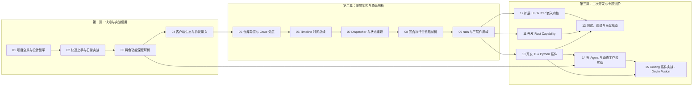

# Dim（dimcode）完全学习指南：从入门使用到架构源码与二次开发

> **Dim** 是一个以 **Rust** 为内核、以**时间总线（Timeline）**为唯一事实源、以 **`rutis` 单树微内核**为扩展底座的下一代本地优先（Local-First）AI Agent 运行时与编程工作台。

欢迎来到《Dim 完全学习指南》。无论你是希望**高效使用 `dimcode`（`dima`）完成日常研发与自动化工作**的终端用户，还是想要**深入理解新一代 AI Agent 运行时底层原理、并基于它进行插件或内核级二次开发**的工程师，本书都会为你提供一条**从浅入深、图文并茂、代码可验证**的完整学习路径。

---

## 本书适合谁？

- **AI 工程应用开发者 / 高级用户**：想系统掌握 `dimcode` 的双模式 TUI、Web 工作区、Timeline 分支、Goal 自治模式、Workflow、定时任务、MCP 与沙盒权限体系。
- **插件与工作流扩展者**：想用 **TypeScript**、**Python**、**Golang** 或 **纯前端 HTML/JS** 为 Dim 编写自定义工具、自动化规则、定时/事件钩子、多 Agent 协同插件或 Web 侧边栏面板。
- **Agent 运行时架构师 / Rust 开发者**：想剖析一个生产级、多协议、可恢复、高并发 AI Agent 内核是如何用 Rust 2024 打造的，并学会编写原生 Rust Capability、Feature Crate，甚至将 `dim-agent-runtime` 嵌入到自己的项目中。

---

## 学习路线图

你可以按需求选择阅读路径：

1. **只想快速上手并发挥全部威力**：精读第 1 ～ 4 章以及第 14 章即可。
2. **想写自定义工具、脚本、Golang 守护进程或面板插件**：读完第 1、2 章后，重点读第 6、7、9 章建立心智模型，然后直接动手做第 10、12、14、15 章。
3. **想修改核心源码、新增原生 Rust 能力或嵌入运行时**：建议通读全书，重点研读第 5 ～ 9 章与第 11 ～ 15 章。

---

## 章节目录

| 章节 | 文件 | 核心内容摘要 |
| --- | --- | --- |
| **第 1 章** | [01-overview-and-philosophy.md](./01-overview-and-philosophy.md) | **项目全景与核心设计哲学**：为什么造 Dim、六大核心特色、与传统 Agent 框架的本质差异、核心术语词汇表 |
| **第 2 章** | [02-quickstart-and-daily-usage.md](./02-quickstart-and-daily-usage.md) | **快速上手与日常实战指南**：安装与 `./dev` 隔离运行、模型与 OAuth 配置、Scrollback/Fullscreen 双模式 TUI、高效率键位与常用命令 |
| **第 3 章** | [03-core-features-deep-dive.md](./03-core-features-deep-dive.md) | **特色功能深度解析**：Branch vs Subagent vs Fork 三分法、Goal/Pursuit 自治模式、Workflow、定时任务、CodeMode、EventHub、权限沙盒与多模态 |
| **第 4 章** | [04-clients-and-protocols.md](./04-clients-and-protocols.md) | **客户端生态、Web 工作区与外部协议**：App Server 守护进程、UI Leaf 机制、Web Workspace、Headless `exec`、`--verify`、ACP 网关与 MCP |
| **第 5 章** | [05-repo-and-crate-architecture.md](./05-repo-and-crate-architecture.md) | **代码仓库导览与 27 个 Crate 分层架构**：单二进制多角色入口、Crate 依赖 DAG、依赖红线与 `xtask` 架构守护 |
| **第 6 章** | [06-timeline-and-event-model.md](./06-timeline-and-event-model.md) | **核心基石 —— Timeline 时间总线与数据契约**：`AgentEvent`、序列号公理、原子批提交、`before` 钩子、扩展事件域与 SQLite 持久化 |
| **第 7 章** | [07-dispatcher-and-capabilities.md](./07-dispatcher-and-capabilities.md) | **并发模型 —— Dispatcher、Capability 与状态重建**：串行分发器、20 个内置 Capability、`dispatcher.consume` 重建与实时衔接、副作用不重放铁律 |
| **第 8 章** | [08-turn-execution-pipeline.md](./08-turn-execution-pipeline.md) | **回合执行引擎全链路剖析**：`InputQueue`（Queue/Steer/Append）→ `Prompt` → `ContextPreparation` → `AgentLoop` → `Aimux` → `ToolExecutor/Approval` |
| **第 9 章** | [09-rutis-and-scope-tree.md](./09-rutis-and-scope-tree.md) | **插件底座 `rutis` 与单树三层作用域模型**：Process/Session/Branch 四级实例树、状态归属原则、`Names::key`、`PartRegistry` 与跨语言数据面 |
| **第 10 章** | [10-dev-ts-and-python-plugins.md](./10-dev-ts-and-python-plugins.md) | **二次开发实战（一）：编写 TypeScript 与 Python 插件**：`dim-plugin.json`、工具与 Settings、Branch 消费器、扩展事件、热重载技巧与 Python 插件实战 |
| **第 11 章** | [11-dev-rust-capabilities-and-features.md](./11-dev-rust-capabilities-and-features.md) | **二次开发实战（二）：编写 Rust 原生 Capability 与 Feature Crate**：`DynPlugin` vs `Feature`、`extension-a/b` 拆解、仿 `dim-goal` 全套架构与测试 |
| **第 12 章** | [12-dev-ui-rpc-and-embedding.md](./12-dev-ui-rpc-and-embedding.md) | **二次开发实战（三）：扩展 UI、自定义 RPC 与嵌入 Runtime**：零构建 Web 面板扩展、自定义 Session/Management RPC、用 `MinimalHost` 嵌入 Dim 内核 |
| **第 13 章** | [13-testing-debugging-and-contributing.md](./13-testing-debugging-and-contributing.md) | **工程质量保障、排障调试与贡献指南**：`xtask check/graph/types/measure`、tmux E2E、`--export` 与 `recording` 诊断、减法审查工程文化 |
| **第 14 章** | [14-multi-agent-and-dynamic-workflow.md](./14-multi-agent-and-dynamic-workflow.md) | **专题进阶：多 Agent 协作与动态工作流实战**：`branch` / `agent` / `workflow` 三层武器库、Collaboration 团队机制与审批桥接、`@dimcode/workflow` 调度/恢复原理与实战 |
| **第 15 章** | [15-dev-golang-plugin-devin-fusion.md](./15-dev-golang-plugin-devin-fusion.md) | **专题实战：用 Golang 编写 Dim 插件实现 Devin Fusion**：纯 Go MCP vs Go Daemon (`fusiond`) + 薄 TS `rutis` 桥接、Lead/Sidekick 持久链路、mid-handoff steer 与 `FusionUsage` 节支账本（参考 [devin-cli-fusion-research.md](./devin-cli-fusion-research.md)） |

---

## 阅读约定

- 文中所有源码路径（如 `crates/dimcode/src/main.rs`）均以仓库根目录 `/home/yj/github.com/yangjuncode/dim` 为基准，你可以直接在编辑器中打开对照阅读。
- 文中会清晰区分**当前仓库已落地实现的能力**与**架构设计文档中演进中的规划特性**（例如 `RemoteGateway`），确保你在实战与二次开发时不踩空。
- 强烈建议在阅读第 2 章后使用仓库根目录的 `./dev` 脚本运行开发环境——它会自动隔离到 `~/.dimcode-dev`，不会污染你的日常正式数据目录 `~/.dimcode`。
